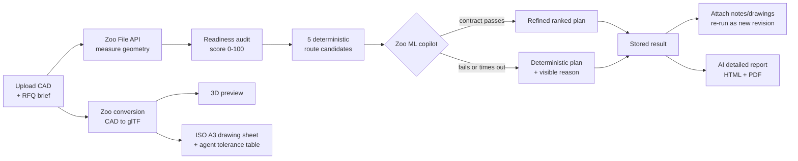

# QuoteReady Studio

[](https://zoo.dev/events/api-makeathon)
[](https://zoo.dev/docs/developer-tools/api)
[](https://nextjs.org)
[](LICENSE)

**Turn a CAD file into a quote-ready manufacturing dossier — measured geometry,
readiness evidence, comparable process routes, priced ranges, and a real ISO
technical drawing — without leaving the browser.**

Built for the **Zoo API Makeathon 2026**. Zoo is the engine, not a badge: every
measurement, the 3D preview, the drawing geometry, the tolerance proposals and
the manufacturing recommendation come from Zoo APIs.


<sub>Generated from `USB Holder.step` with no manual drafting: first-angle views with
hidden-line removal, section A–A, ISO 1101 feature-control frames, ballooned callouts and
an ISO 7200 title block.</sub>

---

## Demo

https://github.com/user-attachments/assets/431e0769-db9f-4be8-979d-054fe356bfb1

(1 min 15 s, 1920 × 1080)

<sub>Upload a STEP file, Zoo converts and measures it live, the app compares
five priced manufacturing routes, then the same part is replanned against the
machines just added to My Factory: three routes instead of five, every one of
them runnable in-house. It closes on the two artefacts — the A4 engineering
report and the ISO A3 technical drawing whose datum frame and tolerance table
the Zoo agent proposed. Chapter list in
<a href="docs/DEMO.md#recorded-walkthrough-chapters">docs/DEMO.md</a>.</sub>

---

## The problem

A CAD file arriving in an inbox is not a quote. Between "here is the model" and
"here is the price" sits an hour of unpaid, error-prone work that every job shop
and estimator repeats by hand:

1. **Measure it.** Volume, surface area, mass, centre of mass — needed for
   stock, cost and handling. Requires a CAD kernel most quoting tools do not
   have.
2. **Check the brief.** Are the units explicit? Is the material named? Is there
   a quantity, a tolerance, a finish, a drawing? A missing unit invalidates
   every dimension downstream; a missing tolerance can change the machine.
3. **Choose a route.** Mill from billet? Turn it? Print it? Laser + bend +
   finish? Each has a different cost curve and a different fit to the shop's
   actual machines.
4. **Price it.** Fast enough to answer today, honest enough to defend later.
5. **Detail it.** Datums, dimensional and geometric tolerances, an inspection
   table, a drawing sheet — the artefacts the shop floor actually needs.

Steps 1 and 5 are the expensive ones, and they are exactly where a geometry API
changes the economics.

## The solution, and why it is built this way

QuoteReady Studio is a decision-support workspace that runs those five steps as
one traceable pipeline and **labels the provenance of every number** it shows.

Three design decisions drive the whole codebase:

**1. Four kinds of evidence are never mixed.** Every value in a report is
tagged as one of:

| Evidence | Source | Example |
|---|---|---|
| **Measured** | Zoo File API | volume 18 420 mm³, mass 49.7 g |
| **Declared** | the user's RFQ brief | material, quantity, units, tolerance |
| **Deterministic** | local engineering rules | readiness score, five route baselines |
| **AI recommendation** | Zoo ML copilot | route ranking, price refinement, datums |

A readiness check that fails because the *user* did not supply units reads
differently from one that fails because *Zoo* could not measure the solid — so
the report says which. Nothing is silently interpolated: a metric Zoo could not
return stays `null` and appears as "unavailable", never as an unlabelled guess.

**2. Deterministic first, AI second, always bounded.** The five candidate
routes, their operations and their cost baselines are computed locally *before*
any AI call. The Zoo ML copilot is then asked to re-rank and refine them, and
its answer is accepted only if it passes a hard contract: known route IDs only,
`0 < min ≤ expected ≤ max`, confidence in `[0,1]`, and prices and lead times
inside **0.25×–4×** of the deterministic baseline. Anything else — timeout,
malformed JSON, an invented route, an implausible price — falls back to the
deterministic plan with the reason printed in the report. The AI can make the
answer better; it can never make it unsafe, and a Zoo outage degrades quality
rather than breaking the product.

**3. Estimates are estimates.** Prices are indicative EUR planning ranges with
an explicit confidence, not quotations. The generated drawing table is a
reviewable proposal, not a released drawing. The product says so, in the UI and
in every export.

The result is a workspace an estimator can actually defend in a review: for
every number, *where did this come from, and what happens if it is wrong?*


## What it does

### The workflow



### Nine views

| # | View | What it does |
|---|---|---|
| 01 | Overview | Workspace KPIs and recent activity |
| 02 | Planning | RFQ intake, CAD/drawing drop zones, live analysis, interactive report |
| 03 | Zoo library | Lists up to 50 Zoo projects; uploads local CAD as a new Zoo draft project |
| 04 | Parts | Uploaded parts with status and interactive glTF 3D preview |
| 05 | Drawings | Agent-generated datum/tolerance tables, drawing chat, ISO A3 PDF export |
| 06 | Results | Stored analyses, folders, tags, attachments, re-runs, route selection |
| 07 | Reports | AI-written detailed engineering reports (HTML + server-rendered PDF) |
| 08 | My factory | Machine capabilities: process, materials, hourly rate, setup minutes |
| 09 | Settings | Timezone, currency, theme, AI model, OpenAI key, personal Zoo API token |

Every list view (Results, Reports, Parts, Drawings) shares one control set:
free-text search, multi-select status and tag filters, and sortable
name / status / updated columns.

### Capabilities in detail

| Area | Capability |
|---|---|
| Intake | Local CAD upload (STEP/STP, STL, OBJ, PLY, SLDPRT, IPT, SAT, Parasolid), optional PDF/PNG/JPEG drawing, RFQ metadata, drag & drop everywhere |
| Geometry | Volume, surface area, centre of mass, and mass via Zoo; partial-failure traces per endpoint |
| Readiness | 8 evidence checks, 0–100 score, `ready` / `review` / `blocked`, up to 5 prioritised clarification questions |
| Route planning | Five deterministic candidates including a four-operation hybrid route, each with operations, setup/cycle minutes, EUR range, confidence, lead time, reasons and risks |
| Factory fit | A route is "available in factory" only when every operation process has an enabled machine that covers the material |
| AI refinement | Zoo copilot re-ranking under a strict numeric contract, with per-user workshop memory as a tie-breaker |
| Reliability | Deterministic fallback with the failure reason stored on the plan |
| Technical drawings | Real ISO A3 sheet: first-angle views, section A-A with 45° hatching, ISO 129 dimensions, ISO 5459 datum indicators, ISO 1101 GD&T frames, ISO 6433 balloons cross-referenced to the table, ISO 7200 title block — rendered server-side with Chromium |
| Detailed reports | Background AI generation (your own OpenAI key) to standalone HTML with inline SVG illustrations, plus server-rendered A4 PDF |
| Revisions | Attach notes/drawings to a result, then re-run: a **new** linked result is stored (`sourceResultId` + `revision`), history is never overwritten |
| Naming | Drawings and reports get `{part}_NN`; results get `{part}_{YYYY-MM-DD}` in the user's timezone |
| Overwrites | Re-using a part name requires explicit confirmation; the replaced part is hidden, never deleted, so old results still resolve their original geometry |
| Library | Private folders, tags, archive, trash, persistent route selection |
| Persistence | Pluggable workspace store (Postgres JSONB or single-file JSON) and blob store (S3-compatible or filesystem) |
| Deployment | One standalone Next.js container behind Traefik, no published host port |

### Two analysis modes

- **Live mode** — a real CAD upload measured by Zoo. Requires a Zoo session and
  a complete RFQ package (part name, material, units, quantity); target
  process, tolerance and finish are optional and default to
  "let the app propose", `ISO 2768-m` and `As Machined`.
- **Sample mode** — a fixed bracket with fixed metrics, for demonstrating the
  full output shape when no CAD file is at hand. The geometry is labelled as
  fixed sample data, never as Zoo evidence.

Selecting a Zoo library project pre-fills planner context; it does **not**
download the project's geometry. A local CAD file is still required for a live
run.

---

## Architecture


Components, trust boundaries and request sequences are documented in
[docs/ARCHITECTURE.md](docs/ARCHITECTURE.md).

---

## Screens

|     |     |
| --- | --- |
|  |  |
| **Overview** — reports, quote readiness, factory assets | **Parts** — every uploaded part and its status |
|  |  |
| **3D preview** — the glTF Zoo converted, in the browser | **Drawings** — automated drawing tables |
|  |  |
| **Drawing table** — datums and GD&T from the Zoo agent, editable by chat | **Results** — attach specs, swap the CAD, re-run without overwriting |

_All screenshots are 1920×1080. The full set, including Reports, Zoo library, Planner and
My factory, is in [`contest/images/`](contest/images/)._

---

## Setup from zero

### Prerequisites

- **Node.js 24+** and npm (the container image is built on `node:24-alpine`).
- A **Zoo account** and a **Zoo OAuth application**
- A **personal Zoo API token** (Zoo dashboard → API tokens) for the library,
  CAD upload, drawing generation and drawing chat. Pasted into the in-app
  Settings page, not into `.env`.
- Optional: **Chromium** on the local machine for PDF export
  (`apt install chromium` or set `PUPPETEER_EXECUTABLE_PATH`). Without it PDF
  endpoints answer `503` and everything else works; the container ships its own.
- Optional: an **OpenAI API key** for the AI detailed reports, also entered in
  Settings.
- For the Docker deployment: Docker Engine with the Compose plugin and the
  external `proxy_public` network used by Traefik.

### 1. Register the OAuth callback

In the Zoo OAuth application register the exact callback you will use. For local
development:

```text
http://localhost:3000/api/auth/callback
```

Scheme, host, port, path and trailing slash must match `ZOO_OAUTH_REDIRECT_URI`
character for character.

### 2. Configure the environment

```bash
npm ci
cp .env.example .env.local
```

`.env.example` is annotated; this is what each variable does.

**Required in every deployment**

| Variable | Purpose |
|---|---|
| `ZOO_OAUTH_CLIENT_ID` | Public client ID of your Zoo OAuth application |
| `ZOO_OAUTH_REDIRECT_URI` | The exact registered callback; also the origin used for CSRF checks and post-login redirects |
| `QUOTE_READY_SESSION_SECRET` | ≥ 32 chars; AES-256-GCM key material for the session and secret-at-rest envelopes. Generate it: `node -e "console.log(require('crypto').randomBytes(32).toString('base64url'))"` |

**Workspace persistence** — `QUOTEREADY_STORAGE_DRIVER`

| Value | Behaviour |
|---|---|
| `json` (code default) | One pretty-printed `data/platform.json`, written with a `0600` temp file + atomic rename. Single process only. |
| `postgres` (compose default) | One row-locked JSONB document per user in `quoteready_workspaces`; schema auto-created. Needs `QUOTEREADY_DATABASE_URL` (or `DATABASE_URL`). |

**Blob storage** (uploaded CAD, glTF previews, attachments) — `QUOTEREADY_BLOB_DRIVER`

| Value | Behaviour |
|---|---|
| `fs` (code default) | Files under `<data dir>/blobs`, atomic writes, mode `0600`. |
| `s3` (compose default) | Any S3-compatible endpoint. Needs `QUOTEREADY_S3_BUCKET`, `QUOTEREADY_S3_ACCESS_KEY_ID`, `QUOTEREADY_S3_SECRET_ACCESS_KEY`; optional `QUOTEREADY_S3_ENDPOINT`, `QUOTEREADY_S3_REGION` (default `us-east-1`), `QUOTEREADY_S3_FORCE_PATH_STYLE` (default `true`, which is what MinIO expects). |

**Other**

| Variable | Purpose |
|---|---|
| `QUOTEREADY_PERSIST_UPLOADS` | `true` archives the analysed CAD and drawing next to each stored result. Compose sets `true`; the code default is `false`. |
| `QUOTEREADY_DATA_DIR` / `QUOTE_READY_DATA_DIR` | Root for the JSON store and `fs` blobs. Defaults to `./data`; the container sets `/app/data`. |
| `QUOTEREADY_HOST`, `TZ` | Traefik router host and container timezone — used by `docker-compose.yml`, not by the app itself. |
| `QUOTEREADY_DB_USER`, `QUOTEREADY_DB_NAME`, `DB_QUOTEREADY_PASSWORD`, `QUOTEREADY_MINIO_ROOT_USER`, `QUOTEREADY_MINIO_ROOT_PASSWORD` | Credentials for the bundled Postgres and MinIO services; Compose builds `QUOTEREADY_DATABASE_URL` and the S3 keys from them. |

> **Running locally without Postgres or MinIO?** `.env.example` ships the
> Compose defaults (`postgres` / `s3`). For a zero-dependency `npm run dev`, set
> `QUOTEREADY_STORAGE_DRIVER=json` and `QUOTEREADY_BLOB_DRIVER=fs` in
> `.env.local` — or delete both lines to fall back to the code defaults.

Minimum viable `.env.local`:

```dotenv
ZOO_OAUTH_CLIENT_ID=your-public-client-id
ZOO_OAUTH_REDIRECT_URI=http://localhost:3000/api/auth/callback
QUOTE_READY_SESSION_SECRET=at-least-32-random-characters
QUOTEREADY_STORAGE_DRIVER=json
QUOTEREADY_BLOB_DRIVER=fs
QUOTEREADY_PERSIST_UPLOADS=true
```

`QUOTEREADY_PERSIST_UPLOADS=true` is worth setting even locally: re-running an
analysis and generating a drawing table both need the archived CAD file.

### 3. Run it

```bash
npm run dev          # http://localhost:3000
```

### 4. First login

1. Open `http://localhost:3000`. Every view is gated, so you land on `/login`.
2. Press **Connect Zoo** and approve the `user:read modeling` scopes. You return
   to `/?auth=success` with a sealed session cookie.
   (If the button reads *"OAuth setup needed"*, one of the three required
   variables is missing or the secret is shorter than 32 characters.)
3. Open **09 Settings** and paste your **personal Zoo API token**. Without it
   the geometry calls still work through the OAuth token where Zoo allows it,
   but the library, CAD upload, drawing tables and drawing chat stay disabled.
   Add an **OpenAI API key** here too if you want AI detailed reports.
4. Open **02 Planning**, drop a STEP file, fill part name / material / units /
   quantity, and press **Build manufacturing plan**. Or press **Run sample**
   for the fixed-geometry walkthrough.
5. Open **04 Parts** to see the glTF preview, then **05 Drawings** →
   *Generate drawing table* → **Download PDF** for the ISO A3 sheet.

### 5. Docker deployment

The bundled `docker-compose.yml` brings up the whole data layer:

| Service | Image | Role |
|---|---|---|
| `quoteredy-studio` | built from `./Dockerfile` | The Next.js standalone app + Chromium, 2 GiB / 2 CPU |
| `quoteredy-db` | `postgres:18` | Workspace store, bind mount `./postgres` |
| `quoteredy-minio` | `minio/minio` | Blob store, bind mount `./minio` |
| `quoteredy-minio-init` | `minio/mc` | One-shot bucket bootstrap, then exits |

Only `quoteredy-studio` joins the external `proxy_public` network (Traefik);
everything else sits on the `internal: true` `quoteredy_internal` network. No
host port is published.

```bash
cp .env.example .env      # fill in the OAuth, secret, DB and MinIO values
install -d -m 700 data
docker compose config --quiet
docker compose up -d --build
docker compose ps
```

Verify from inside the container and through Traefik:

```bash
docker exec quoteredy-studio wget -qO- http://127.0.0.1:3000/api/health
curl --fail "https://${QUOTEREADY_HOST}/api/health"
```


---

## Development guide

### Scripts

| Command | What it does |
|---|---|
| `npm run dev` | Next.js dev server for `@quoteredy/web` |
| `npm run build` | Production build (`output: "standalone"`) |
| `npm start` | Serve the production build |
| `npm run typecheck` | `tsc --noEmit` in all three workspaces |
| `npm run lint` | ESLint (`eslint-config-next`), zero warnings tolerated |
| `npm test` | Vitest across the three workspace projects |
| `npm run format` / `format:check` | Prettier over `.ts`/`.tsx`/`.css`/`.json`/`.mjs` (Markdown is intentionally not covered) |
| `npm run check` | typecheck → lint → test → format:check, in that order |

Run before every commit or deploy:

```bash
npm run check
npm run build
```

### Tests

**118 tests in 13 files** (117 run, 1 opt-in live test skipped by default):

| File | Tests | Covers |
|---|---:|---|
| `apps/web/tests/drawing-sheet.test.ts` | 19 | Sheet layout, view projection, annotation and balloon placement |
| `apps/web/tests/item-naming.test.ts` | 15 | `{part}_NN` sequences, `{part}_{date}` result titles, timezone handling |
| `apps/web/tests/result-context.test.ts` | 13 | Attachment→RFQ context merge, re-run revision chains, part resolution |
| `apps/web/tests/security.test.ts` | 7 | Origin checks, bounded readers, rate windows, single-flight, RFQ validation |
| `apps/web/tests/oauth.test.ts` | 5 | PKCE pair, requested scopes, cookie seal/open, tamper rejection, redirect origin |
| `apps/web/tests/multipart.test.ts` | 4 | Streaming parser, size ceilings, duplicate-field rejection |
| `packages/core/tests/zoo-copilot.test.ts` | 15 | Copilot frame reducer, replay/MsgPack decoding, reconnect state machine |
| `packages/core/tests/manufacturing.test.ts` | 6 | Deterministic routes, factory matching, agent payload validation |
| `packages/core/tests/audit.test.ts` | 4 | Readiness scoring, evidence provenance |
| `packages/core/tests/user-memory.test.ts` | 4 | Workshop-memory distillation and prompt rendering |
| `packages/core/tests/parts.test.ts` | 3 | Part-name normalisation, collision and supersede rules |
| `packages/core/tests/zoo-copilot.live.test.ts` | 1 | Opt-in live copilot contract check (skipped without a token) |
| `packages/storage/tests/platform-store.test.ts` | 22 | Quotas, ownership isolation, attachments, revisions, folder modes |


## Known limitations

Stated plainly, because a decision-support tool that overstates its evidence is
worse than none:

- **Prices are planning ranges, not quotations.** No stock availability, MOQs,
  tooling purchases, scrap, freight, margin or currency movement.
- **Zoo library projects give context, not geometry.** A live analysis still
  needs a local CAD upload.
- **Uploaded drawings are checked for presence and file signature only.** No OCR,
  no dimension extraction, no CAD-vs-drawing reconciliation.
- **The generated drawing table is a proposal.** The copilot's datums and
  tolerances are not verified against process capability or gauging, and the
  drawing views are projected from a *tessellated* mesh, so curved edges are
  polyline approximations. An engineer must review the sheet before release.
- **Feature recognition is mesh-based and heuristic.** It finds planar faces,
  pockets and pocket arrays — not holes, threads, fillets or diameters. Wall
  thickness, tool access, bend feasibility and tolerance stack-up are not
  analysed. Models above 250 000 triangles are refused rather than truncated.
- **Factory modelling is coarse.** Process, materials, hourly rate and setup
  minutes only — no work envelope, axis count, tooling inventory or calendar.
  "Available in factory" means capability match, not scheduling approval.
- **Single replica.** Rate limits, single-flight locks and the JSON driver's
  mutation queue are all process-local.
- **Archive and trash are reversible states,** and items in them still count
  toward quota until the trash is explicitly emptied. Permanent deletion is a
  separate deliberate action, not a side effect of trashing.
- **English only,** with fixed date and EUR presentation.

The complete and deliberately candid list:
[docs/LIMITATIONS.md](docs/LIMITATIONS.md).

## Licence

MIT — see [LICENSE](LICENSE).

---

<sub>Built for the [Zoo API Makeathon](https://zoo.dev/events/api-makeathon), July–August 2026.
Submission materials — demo video, screenshots and diagrams — live in [`contest/`](contest/).
Datums and tolerances are proposed by an AI agent and must be reviewed by a qualified
engineer before a drawing is released.</sub>
