# QuoteReady Studio

[](https://zoo.dev/events/api-makeathon)
[](https://zoo.dev/docs/developer-tools/api)
[](https://nextjs.org)
[](LICENSE)

**Turn a CAD file into a quote-ready manufacturing dossier — measured geometry,
readiness evidence, comparable process routes, priced ranges, and a real ISO
technical drawing — without leaving the browser.**

Built for the **Zoo API Makeathon 2026**. Zoo is the engine, not a badge: every
measurement, the 3D preview, the drawing geometry, the tolerance proposals and
the manufacturing recommendation come from Zoo APIs.

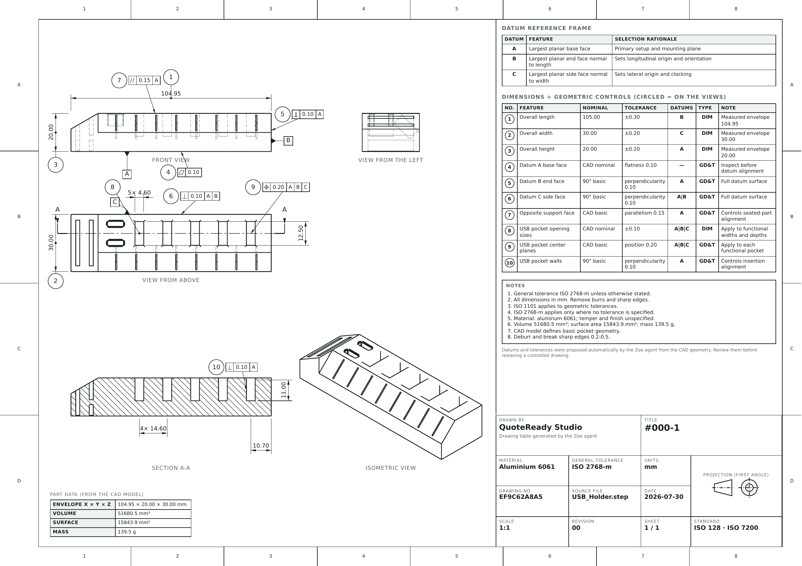

<sub>Generated from `USB Holder.step` with no manual drafting: first-angle views with
hidden-line removal, section A–A, ISO 1101 feature-control frames, ballooned callouts and
an ISO 7200 title block.</sub>

---

## Demo

<!-- After the repository is pushed: open this file in GitHub's web editor, drag
     contest/demo.mp4 into the edit box, and replace the link line below with the
     bare https://github.com/user-attachments/assets/… URL GitHub inserts. Left
     on its own line, that URL renders as an inline video player. Do not wrap it
     in  or <video> — both break the player. -->

**[▶ Watch the walkthrough — contest/demo.mp4](contest/demo.mp4)** (1 min 15 s, 1920 × 1080)

<sub>Upload a STEP file, Zoo converts and measures it live, the app compares
five priced manufacturing routes, then the same part is replanned against the
machines just added to My Factory: three routes instead of five, every one of
them runnable in-house. It closes on the two artefacts — the A4 engineering
report and the ISO A3 technical drawing whose datum frame and tolerance table
the Zoo agent proposed. Chapter list in
<a href="docs/DEMO.md#recorded-walkthrough-chapters">docs/DEMO.md</a>.</sub>

> **Notes for the Zoo team:** while building this we kept a running log of API behaviour,
> documentation gaps and rough edges — see [`docs/ZOO_API_NOTES.md`](docs/ZOO_API_NOTES.md).

---

## The problem

A CAD file arriving in an inbox is not a quote. Between "here is the model" and
"here is the price" sits an hour of unpaid, error-prone work that every job shop
and estimator repeats by hand:

1. **Measure it.** Volume, surface area, mass, centre of mass — needed for
   stock, cost and handling. Requires a CAD kernel most quoting tools do not
   have.
2. **Check the brief.** Are the units explicit? Is the material named? Is there
   a quantity, a tolerance, a finish, a drawing? A missing unit invalidates
   every dimension downstream; a missing tolerance can change the machine.
3. **Choose a route.** Mill from billet? Turn it? Print it? Laser + bend +
   finish? Each has a different cost curve and a different fit to the shop's
   actual machines.
4. **Price it.** Fast enough to answer today, honest enough to defend later.
5. **Detail it.** Datums, dimensional and geometric tolerances, an inspection
   table, a drawing sheet — the artefacts the shop floor actually needs.

Steps 1 and 5 are the expensive ones, and they are exactly where a geometry API
changes the economics.

## The solution, and why it is built this way

QuoteReady Studio is a decision-support workspace that runs those five steps as
one traceable pipeline and **labels the provenance of every number** it shows.

Three design decisions drive the whole codebase:

**1. Four kinds of evidence are never mixed.** Every value in a report is
tagged as one of:

| Evidence | Source | Example |
|---|---|---|
| **Measured** | Zoo File API | volume 18 420 mm³, mass 49.7 g |
| **Declared** | the user's RFQ brief | material, quantity, units, tolerance |
| **Deterministic** | local engineering rules | readiness score, five route baselines |
| **AI recommendation** | Zoo ML copilot | route ranking, price refinement, datums |

A readiness check that fails because the *user* did not supply units reads
differently from one that fails because *Zoo* could not measure the solid — so
the report says which. Nothing is silently interpolated: a metric Zoo could not
return stays `null` and appears as "unavailable", never as an unlabelled guess.

**2. Deterministic first, AI second, always bounded.** The five candidate
routes, their operations and their cost baselines are computed locally *before*
any AI call. The Zoo ML copilot is then asked to re-rank and refine them, and
its answer is accepted only if it passes a hard contract: known route IDs only,
`0 < min ≤ expected ≤ max`, confidence in `[0,1]`, and prices and lead times
inside **0.25×–4×** of the deterministic baseline. Anything else — timeout,
malformed JSON, an invented route, an implausible price — falls back to the
deterministic plan with the reason printed in the report. The AI can make the
answer better; it can never make it unsafe, and a Zoo outage degrades quality
rather than breaking the product.

**3. Estimates are estimates.** Prices are indicative EUR planning ranges with
an explicit confidence, not quotations. The generated drawing table is a
reviewable proposal, not a released drawing. The product says so, in the UI and
in every export.

The result is a workspace an estimator can actually defend in a review: for
every number, *where did this come from, and what happens if it is wrong?*

---

## How QuoteReady Studio uses Zoo APIs

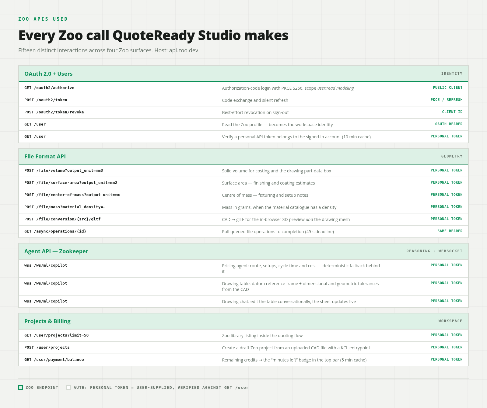

Fifteen distinct Zoo calls across five services. All calls are server-side; the
browser never holds a Zoo token and never talks to `api.zoo.dev` directly.

### 1. Identity — Zoo OAuth

`apps/web/lib/zoo-auth.ts`, `apps/web/lib/oauth.ts`

| Endpoint | Use |
|---|---|
| `GET /oauth2/authorize` | Authorization Code + S256 PKCE sign-in (scope `user:read modeling`) |
| `POST /oauth2/token` | Code exchange and refresh-token rotation |
| `POST /oauth2/token/revoke` | Best-effort token revocation on sign-out |
| `GET /user` | Workspace identity, display profile, and verification that a stored personal API token belongs to the signed-in account |

The Zoo account **is** the tenant: the workspace is keyed by the Zoo user ID,
and there is no local password, user table or registration. Tokens live only
inside an AES-256-GCM sealed, `HttpOnly` cookie (30-day absolute lifetime,
refreshed within 60 s of expiry).

### 2. Geometry — Zoo File API

`apps/web/lib/zoo.ts`

| Endpoint | Returns |
|---|---|
| `POST /file/volume?src_format=…&output_unit=mm3` | solid volume, mm³ |
| `POST /file/surface-area?src_format=…&output_unit=mm2` | surface area, mm² |
| `POST /file/center-of-mass?src_format=…&output_unit=mm` | centre of mass, mm |
| `POST /file/mass?src_format=…&material_density=…&material_density_unit=kg%3Am3&output_unit=g` | mass, g (only when the chosen material has a known density) |
| `GET /async/operations/{id}` | polling for operations that queue |

The four metrics are POSTed **concurrently** as `application/octet-stream`
bodies under **one shared 45 s abort deadline** (per call: 20 s initial timeout,
then up to 18 polls at 500 ms, 8 s each, 128 KiB response ceiling). A metric
that fails does **not** fail the analysis: it becomes a `failed` entry in the
report's `apiTrace` and the corresponding value stays `null`. Missing volume is
the one metric that blocks quote readiness.

These numbers feed the readiness audit, the mass-based material cost, the
surface-to-volume complexity proxy that drives cycle-time estimates, and the
part-data box on the drawing sheet.

### 3. CAD translation — Zoo File Conversion API

`apps/web/lib/zoo-model.ts`

| Endpoint | Use |
|---|---|
| `POST /file/conversion/{src_format}/gltf` | Convert uploaded CAD (STEP, STL, OBJ, PLY, SLDPRT, FBX) to embedded glTF |

This is the load-bearing call for two features at once:

- the **interactive 3D preview** in the Parts view (`<model-viewer>` renders the
  stored glTF, served back by `GET /api/parts/model`);
- the **technical drawing sheet** — the whole drafting pipeline projects the
  triangle mesh that comes out of this conversion. Without Zoo's translator
  there would be no tessellated geometry to project, and the app would need a
  local CAD kernel.

The conversion is best-effort and asynchronous: large files return an operation
that is polled for up to 45 s, and a failure degrades the part to "no preview"
instead of failing the upload.

### 4. Manufacturing & drafting intelligence — Zoo ML copilot

`packages/core/src/zoo-copilot.ts` (protocol), `packages/core/src/pricing.ts`,
`apps/web/lib/drawing-generation.ts`

| Endpoint | Use |
|---|---|
| `wss://api.zoo.dev/ws/ml/copilot` | Three distinct prompts, all text-only (`forced_tools: []`) |
| `wss://…/ws/ml/copilot?replay=true&conversation_id=…` | Resume a turn Zoo interrupted mid-answer |

1. **Manufacturing cost engineer** (80 s budget) — receives the RFQ, the
   measured geometry, the readiness score and the five deterministic candidates,
   and returns a ranked JSON estimate. Validated against the contract above
   before it is allowed near a report. It is also given a bounded *workshop
   memory* — the routes this user previously selected, their frequent materials
   and typical quantities — framed explicitly as a tie-breaking signal that must
   never override the current part's evidence.
2. **Drafting engineer** (5 min budget, 2 attempts) — receives the archived CAD
   file as a project file plus the already-measured facts, and chooses the datum
   reference frame (A, B, C) and the dimensional and geometric tolerance rows
   itself. The JSON answer is parsed and bounded (≤ 6 datums, ≤ 40 rows,
   200 chars per field) before it is stored.
3. **Drawing chat** (120 s budget) — an interactive turn that edits the existing
   drawing table from a natural-language request ("tighten the bore to H7",
   "add flatness on the base") and returns the updated table plus a one-sentence
   reply.

The websocket client is the hardest-won part of this integration. Zoo recycles
copilot backends mid-prompt, so `runCopilotPrompt` implements in-band
authentication, a 30 s ping keepalive, a 5-minute stall watchdog, exponential
reconnect with `?replay=true` (including a MsgPack decoder for the binary replay
frame), an explicit `continue` resume command, and harvesting of partial output
so an interrupted turn is never thrown away. Every failure carries diagnostics
("conversation established, 0 chars streamed, 3 reconnects, api call …").
See **[docs/ZOO_API_NOTES.md](docs/ZOO_API_NOTES.md)** for the full field report.

### 5. Design library & account — Zoo Projects and Billing

`apps/web/app/api/zoo/projects/route.ts`, `apps/web/app/api/zoo/upload/route.ts`,
`apps/web/app/api/zoo/usage/route.ts`

| Endpoint | Use |
|---|---|
| `GET /user/projects?limit=50` | List the signed-in account's Zoo projects; selecting one pre-fills planner context |
| `POST /user/projects` | Push a local CAD file to Zoo as a new draft project (multipart: `project.toml`, `main.kcl` entrypoint, the CAD file) |
| `GET /user/payment/balance` | Remaining `monthly_` + `stable_api_credits_remaining`, shown as the "minutes left" badge in the top bar (cached 5 min per user) |

> **Token reality check.** Zoo's OAuth scope set (`user:read`, `modeling`,
> `admin:write`) has no Projects or ML scope, so a third-party OAuth token gets
> **HTTP 403** from `/file/*`, `/user/projects` and the copilot socket. Every
> server-side call therefore goes through `resolveProjectsToken()`, which
> prefers a **personal Zoo API token** the user pastes into Settings — used only
> after `GET /user` confirms it belongs to the signed-in account — and falls back
> to the OAuth token. Library, upload, drawing generation and drawing chat
> require that personal token and say so in the UI. This is the single biggest
> integration finding of the project; it is written up in
> [docs/ZOO_API_NOTES.md](docs/ZOO_API_NOTES.md).

---

## What it does

### The workflow

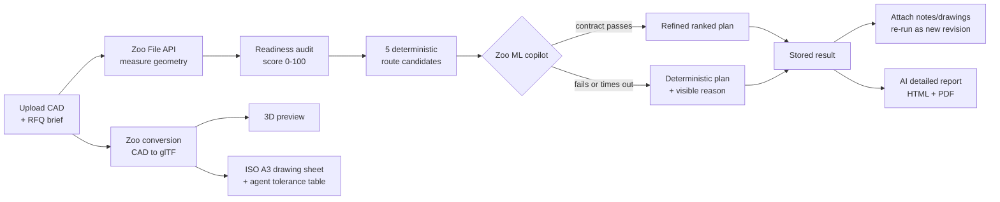

### Nine views

| # | View | What it does |
|---|---|---|
| 01 | Overview | Workspace KPIs and recent activity |
| 02 | Planning | RFQ intake, CAD/drawing drop zones, live analysis, interactive report |
| 03 | Zoo library | Lists up to 50 Zoo projects; uploads local CAD as a new Zoo draft project |
| 04 | Parts | Uploaded parts with status and interactive glTF 3D preview |
| 05 | Drawings | Agent-generated datum/tolerance tables, drawing chat, ISO A3 PDF export |
| 06 | Results | Stored analyses, folders, tags, attachments, re-runs, route selection |
| 07 | Reports | AI-written detailed engineering reports (HTML + server-rendered PDF) |
| 08 | My factory | Machine capabilities: process, materials, hourly rate, setup minutes |
| 09 | Settings | Timezone, currency, theme, AI model, OpenAI key, personal Zoo API token |

Every list view (Results, Reports, Parts, Drawings) shares one control set:
free-text search, multi-select status and tag filters, and sortable
name / status / updated columns.

### Capabilities in detail

| Area | Capability |
|---|---|
| Intake | Local CAD upload (STEP/STP, STL, OBJ, PLY, SLDPRT, IPT, SAT, Parasolid), optional PDF/PNG/JPEG drawing, RFQ metadata, drag & drop everywhere |
| Geometry | Volume, surface area, centre of mass, and mass via Zoo; partial-failure traces per endpoint |
| Readiness | 8 evidence checks, 0–100 score, `ready` / `review` / `blocked`, up to 5 prioritised clarification questions |
| Route planning | Five deterministic candidates including a four-operation hybrid route, each with operations, setup/cycle minutes, EUR range, confidence, lead time, reasons and risks |
| Factory fit | A route is "available in factory" only when every operation process has an enabled machine that covers the material |
| AI refinement | Zoo copilot re-ranking under a strict numeric contract, with per-user workshop memory as a tie-breaker |
| Reliability | Deterministic fallback with the failure reason stored on the plan |
| Technical drawings | Real ISO A3 sheet: first-angle views, section A-A with 45° hatching, ISO 129 dimensions, ISO 5459 datum indicators, ISO 1101 GD&T frames, ISO 6433 balloons cross-referenced to the table, ISO 7200 title block — rendered server-side with Chromium |
| Detailed reports | Background AI generation (your own OpenAI key) to standalone HTML with inline SVG illustrations, plus server-rendered A4 PDF |
| Revisions | Attach notes/drawings to a result, then re-run: a **new** linked result is stored (`sourceResultId` + `revision`), history is never overwritten |
| Naming | Drawings and reports get `{part}_NN`; results get `{part}_{YYYY-MM-DD}` in the user's timezone |
| Overwrites | Re-using a part name requires explicit confirmation; the replaced part is hidden, never deleted, so old results still resolve their original geometry |
| Library | Private folders, tags, archive, trash, persistent route selection |
| Persistence | Pluggable workspace store (Postgres JSONB or single-file JSON) and blob store (S3-compatible or filesystem) |
| Deployment | One standalone Next.js container behind Traefik, no published host port |

### Two analysis modes

- **Live mode** — a real CAD upload measured by Zoo. Requires a Zoo session and
  a complete RFQ package (part name, material, units, quantity); target
  process, tolerance and finish are optional and default to
  "let the app propose", `ISO 2768-m` and `As Machined`.
- **Sample mode** — a fixed bracket with fixed metrics, for demonstrating the
  full output shape when no CAD file is at hand. The geometry is labelled as
  fixed sample data, never as Zoo evidence.

Selecting a Zoo library project pre-fills planner context; it does **not**
download the project's geometry. A local CAD file is still required for a live
run.

---

## Architecture

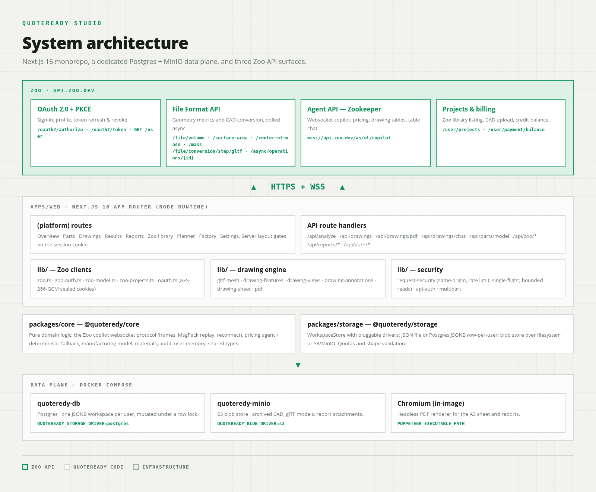

Components, trust boundaries and request sequences are documented in
[docs/ARCHITECTURE.md](docs/ARCHITECTURE.md).

---

## Screens

|     |     |
| --- | --- |
| 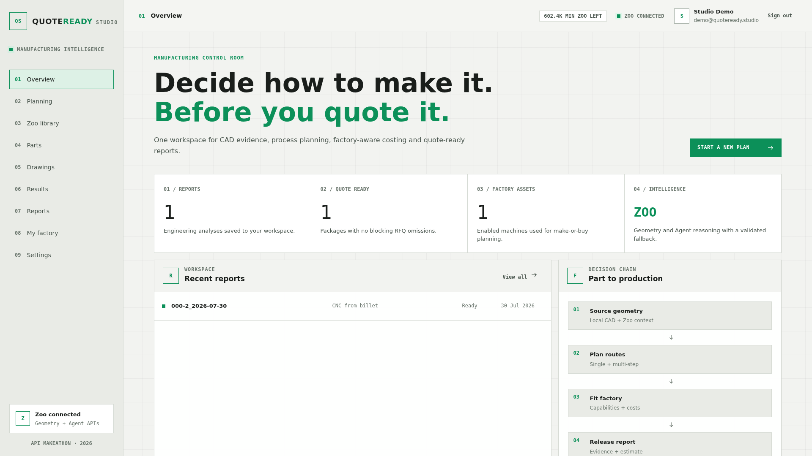 | 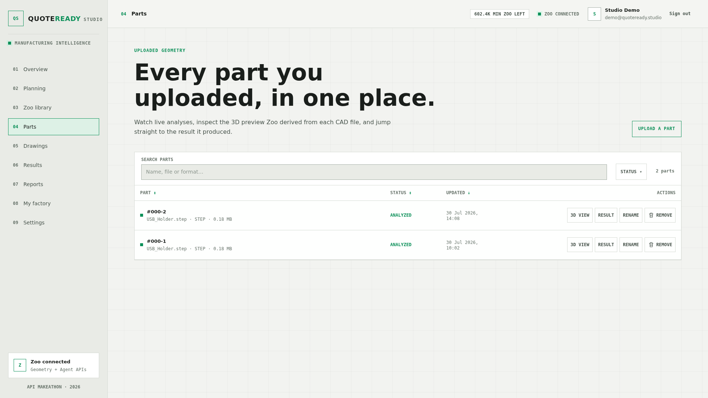 |
| **Overview** — reports, quote readiness, factory assets | **Parts** — every uploaded part and its status |
| 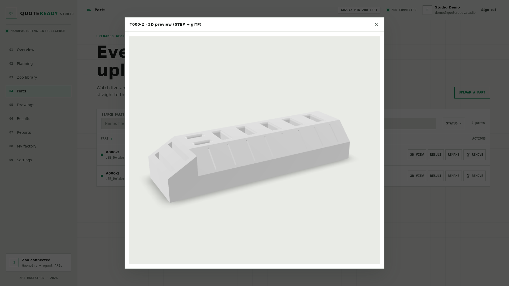 | 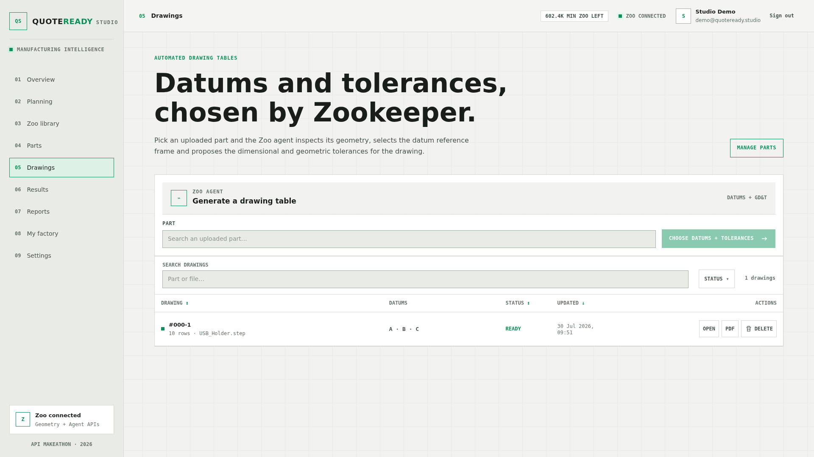 |
| **3D preview** — the glTF Zoo converted, in the browser | **Drawings** — automated drawing tables |
| 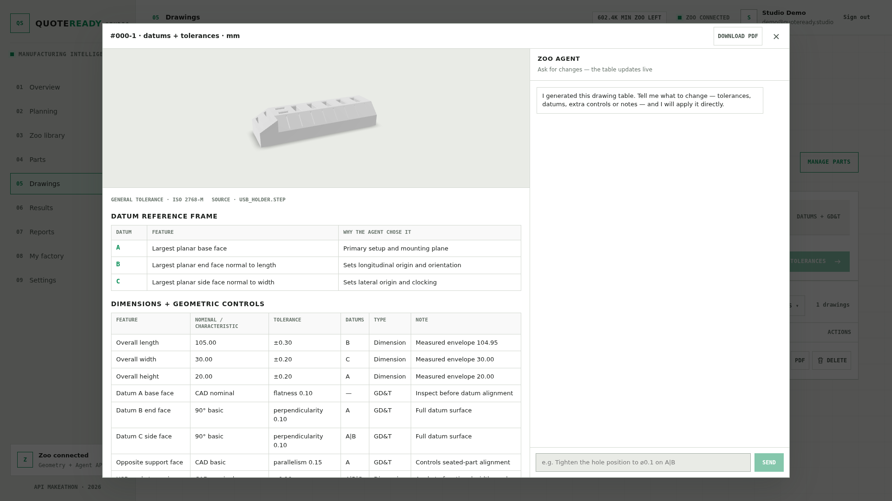 | 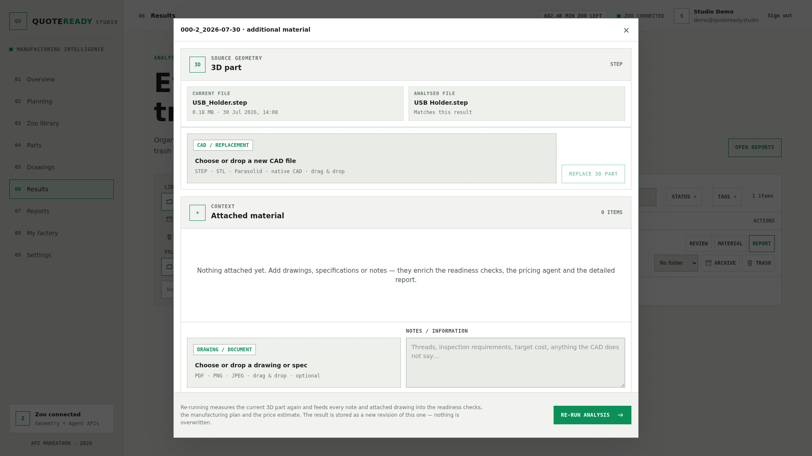 |
| **Drawing table** — datums and GD&T from the Zoo agent, editable by chat | **Results** — attach specs, swap the CAD, re-run without overwriting |

_All screenshots are 1920×1080. The full set, including Reports, Zoo library, Planner and
My factory, is in [`contest/images/`](contest/images/)._

---

## Setup from zero

### Prerequisites

- **Node.js 24+** and npm (the container image is built on `node:24-alpine`).
- A **Zoo account** and a **Zoo OAuth application** — see
  [docs/OAUTH_SETUP.md](docs/OAUTH_SETUP.md).
- A **personal Zoo API token** (Zoo dashboard → API tokens) for the library,
  CAD upload, drawing generation and drawing chat. Pasted into the in-app
  Settings page, not into `.env`.
- Optional: **Chromium** on the local machine for PDF export
  (`apt install chromium` or set `PUPPETEER_EXECUTABLE_PATH`). Without it PDF
  endpoints answer `503` and everything else works; the container ships its own.
- Optional: an **OpenAI API key** for the AI detailed reports, also entered in
  Settings.
- For the Docker deployment: Docker Engine with the Compose plugin and the
  external `proxy_public` network used by Traefik.

### 1. Register the OAuth callback

In the Zoo OAuth application register the exact callback you will use. For local
development:

```text
http://localhost:3000/api/auth/callback
```

Scheme, host, port, path and trailing slash must match `ZOO_OAUTH_REDIRECT_URI`
character for character.

### 2. Configure the environment

```bash
npm ci
cp .env.example .env.local
```

`.env.example` is annotated; this is what each variable does.

**Required in every deployment**

| Variable | Purpose |
|---|---|
| `ZOO_OAUTH_CLIENT_ID` | Public client ID of your Zoo OAuth application |
| `ZOO_OAUTH_REDIRECT_URI` | The exact registered callback; also the origin used for CSRF checks and post-login redirects |
| `QUOTE_READY_SESSION_SECRET` | ≥ 32 chars; AES-256-GCM key material for the session and secret-at-rest envelopes. Generate it: `node -e "console.log(require('crypto').randomBytes(32).toString('base64url'))"` |

**Workspace persistence** — `QUOTEREADY_STORAGE_DRIVER`

| Value | Behaviour |
|---|---|
| `json` (code default) | One pretty-printed `data/platform.json`, written with a `0600` temp file + atomic rename. Single process only. |
| `postgres` (compose default) | One row-locked JSONB document per user in `quoteready_workspaces`; schema auto-created. Needs `QUOTEREADY_DATABASE_URL` (or `DATABASE_URL`). |

**Blob storage** (uploaded CAD, glTF previews, attachments) — `QUOTEREADY_BLOB_DRIVER`

| Value | Behaviour |
|---|---|
| `fs` (code default) | Files under `<data dir>/blobs`, atomic writes, mode `0600`. |
| `s3` (compose default) | Any S3-compatible endpoint. Needs `QUOTEREADY_S3_BUCKET`, `QUOTEREADY_S3_ACCESS_KEY_ID`, `QUOTEREADY_S3_SECRET_ACCESS_KEY`; optional `QUOTEREADY_S3_ENDPOINT`, `QUOTEREADY_S3_REGION` (default `us-east-1`), `QUOTEREADY_S3_FORCE_PATH_STYLE` (default `true`, which is what MinIO expects). |

**Other**

| Variable | Purpose |
|---|---|
| `QUOTEREADY_PERSIST_UPLOADS` | `true` archives the analysed CAD and drawing next to each stored result. Compose sets `true`; the code default is `false`. |
| `QUOTEREADY_DATA_DIR` / `QUOTE_READY_DATA_DIR` | Root for the JSON store and `fs` blobs. Defaults to `./data`; the container sets `/app/data`. |
| `QUOTEREADY_HOST`, `TZ` | Traefik router host and container timezone — used by `docker-compose.yml`, not by the app itself. |
| `QUOTEREADY_DB_USER`, `QUOTEREADY_DB_NAME`, `DB_QUOTEREADY_PASSWORD`, `QUOTEREADY_MINIO_ROOT_USER`, `QUOTEREADY_MINIO_ROOT_PASSWORD` | Credentials for the bundled Postgres and MinIO services; Compose builds `QUOTEREADY_DATABASE_URL` and the S3 keys from them. |

> **Running locally without Postgres or MinIO?** `.env.example` ships the
> Compose defaults (`postgres` / `s3`). For a zero-dependency `npm run dev`, set
> `QUOTEREADY_STORAGE_DRIVER=json` and `QUOTEREADY_BLOB_DRIVER=fs` in
> `.env.local` — or delete both lines to fall back to the code defaults.

Minimum viable `.env.local`:

```dotenv
ZOO_OAUTH_CLIENT_ID=your-public-client-id
ZOO_OAUTH_REDIRECT_URI=http://localhost:3000/api/auth/callback
QUOTE_READY_SESSION_SECRET=at-least-32-random-characters
QUOTEREADY_STORAGE_DRIVER=json
QUOTEREADY_BLOB_DRIVER=fs
QUOTEREADY_PERSIST_UPLOADS=true
```

`QUOTEREADY_PERSIST_UPLOADS=true` is worth setting even locally: re-running an
analysis and generating a drawing table both need the archived CAD file.

### 3. Run it

```bash
npm run dev          # http://localhost:3000
```

### 4. First login

1. Open `http://localhost:3000`. Every view is gated, so you land on `/login`.
2. Press **Connect Zoo** and approve the `user:read modeling` scopes. You return
   to `/?auth=success` with a sealed session cookie.
   (If the button reads *"OAuth setup needed"*, one of the three required
   variables is missing or the secret is shorter than 32 characters.)
3. Open **09 Settings** and paste your **personal Zoo API token**. Without it
   the geometry calls still work through the OAuth token where Zoo allows it,
   but the library, CAD upload, drawing tables and drawing chat stay disabled.
   Add an **OpenAI API key** here too if you want AI detailed reports.
4. Open **02 Planning**, drop a STEP file, fill part name / material / units /
   quantity, and press **Build manufacturing plan**. Or press **Run sample**
   for the fixed-geometry walkthrough.
5. Open **04 Parts** to see the glTF preview, then **05 Drawings** →
   *Generate drawing table* → **Download PDF** for the ISO A3 sheet.

### 5. Docker deployment

The bundled `docker-compose.yml` brings up the whole data layer:

| Service | Image | Role |
|---|---|---|
| `quoteredy-studio` | built from `./Dockerfile` | The Next.js standalone app + Chromium, 2 GiB / 2 CPU |
| `quoteredy-db` | `postgres:18` | Workspace store, bind mount `./postgres` |
| `quoteredy-minio` | `minio/minio` | Blob store, bind mount `./minio` |
| `quoteredy-minio-init` | `minio/mc` | One-shot bucket bootstrap, then exits |

Only `quoteredy-studio` joins the external `proxy_public` network (Traefik);
everything else sits on the `internal: true` `quoteredy_internal` network. No
host port is published.

```bash
cp .env.example .env      # fill in the OAuth, secret, DB and MinIO values
install -d -m 700 data
docker compose config --quiet
docker compose up -d --build
docker compose ps
```

Verify from inside the container and through Traefik:

```bash
docker exec quoteredy-studio wget -qO- http://127.0.0.1:3000/api/health
curl --fail "https://${QUOTEREADY_HOST}/api/health"
```

Full procedure, upgrade and rollback: [docs/DEPLOYMENT.md](docs/DEPLOYMENT.md).
Day-two runbook: [docs/OPERATIONS.md](docs/OPERATIONS.md).

---

## Development guide

### Scripts

| Command | What it does |
|---|---|
| `npm run dev` | Next.js dev server for `@quoteredy/web` |
| `npm run build` | Production build (`output: "standalone"`) |
| `npm start` | Serve the production build |
| `npm run typecheck` | `tsc --noEmit` in all three workspaces |
| `npm run lint` | ESLint (`eslint-config-next`), zero warnings tolerated |
| `npm test` | Vitest across the three workspace projects |
| `npm run format` / `format:check` | Prettier over `.ts`/`.tsx`/`.css`/`.json`/`.mjs` (Markdown is intentionally not covered) |
| `npm run check` | typecheck → lint → test → format:check, in that order |

Run before every commit or deploy:

```bash
npm run check
npm run build
```

### Tests

**118 tests in 13 files** (117 run, 1 opt-in live test skipped by default):

| File | Tests | Covers |
|---|---:|---|
| `apps/web/tests/drawing-sheet.test.ts` | 19 | Sheet layout, view projection, annotation and balloon placement |
| `apps/web/tests/item-naming.test.ts` | 15 | `{part}_NN` sequences, `{part}_{date}` result titles, timezone handling |
| `apps/web/tests/result-context.test.ts` | 13 | Attachment→RFQ context merge, re-run revision chains, part resolution |
| `apps/web/tests/security.test.ts` | 7 | Origin checks, bounded readers, rate windows, single-flight, RFQ validation |
| `apps/web/tests/oauth.test.ts` | 5 | PKCE pair, requested scopes, cookie seal/open, tamper rejection, redirect origin |
| `apps/web/tests/multipart.test.ts` | 4 | Streaming parser, size ceilings, duplicate-field rejection |
| `packages/core/tests/zoo-copilot.test.ts` | 15 | Copilot frame reducer, replay/MsgPack decoding, reconnect state machine |
| `packages/core/tests/manufacturing.test.ts` | 6 | Deterministic routes, factory matching, agent payload validation |
| `packages/core/tests/audit.test.ts` | 4 | Readiness scoring, evidence provenance |
| `packages/core/tests/user-memory.test.ts` | 4 | Workshop-memory distillation and prompt rendering |
| `packages/core/tests/parts.test.ts` | 3 | Part-name normalisation, collision and supersede rules |
| `packages/core/tests/zoo-copilot.live.test.ts` | 1 | Opt-in live copilot contract check (skipped without a token) |
| `packages/storage/tests/platform-store.test.ts` | 22 | Quotas, ownership isolation, attachments, revisions, folder modes |

The full manual, browser and live-Zoo matrix is in
[docs/TESTING.md](docs/TESTING.md).

### Repository layout

An npm-workspaces monorepo, so the domain model and the persistence layer can be
tested without the web layer:

```text
apps/web/                             Next.js 16 app router, route handlers, UI
  app/(platform)/                     The nine authenticated views
  app/login/                          Sign-in gate
  app/api/                            23 route handlers (see docs/API.md)
  components/                         Shell, planner, per-view components
  lib/zoo.ts                          File API metrics + async polling
  lib/zoo-model.ts                    CAD to glTF conversion + preview storage
  lib/zoo-auth.ts                     OAuth exchange, refresh, revoke, session cookie
  lib/zoo-projects.ts                 Personal-token resolution and verification
  lib/gltf-mesh.ts                    glTF/GLB parsing to a millimetre triangle mesh
  lib/drawing-features.ts             Planar-face, pocket and pocket-array recognition
  lib/drawing-views.ts                Orthographic projection, section, hidden lines
  lib/drawing-annotations.ts          ISO 129 dimensions, GD&T frames, balloons
  lib/drawing-sheet.ts                ISO A3 sheet HTML + title block
  lib/drawing-generation.ts           Copilot prompts for tables and chat
  lib/report-ai.ts                    OpenAI detailed-report generation
  lib/pdf.ts                          Puppeteer/Chromium HTML to PDF
  lib/multipart.ts                    Streaming Busboy parser and upload ceilings
  lib/request-security.ts             Origin checks, bounded readers, rate + single-flight
  lib/item-naming.ts                  Sequential and dated naming rules
  lib/part-names.ts                   Duplicate-name 409 contract
  tests/                              Web-layer unit tests
packages/core/                        @quoteredy/core — pure domain logic
  src/types.ts                        Every shared contract
  src/audit.ts                        Readiness evidence and scoring
  src/manufacturing.ts                Deterministic routes and cost baselines
  src/pricing.ts                      Copilot pricing contract, validation, merge, fallback
  src/user-memory.ts                  Per-user workshop memory
  src/zoo-copilot.ts                  ML copilot websocket protocol client
  src/materials.ts, src/parts.ts      Material catalogue, part-identity rules
packages/storage/                     @quoteredy/storage — persistence adapters
  src/workspace-store.ts              Domain operations + env-driven driver factory
  src/json-driver.ts                  Single-file JSON store (atomic rename)
  src/postgres-driver.ts              Postgres JSONB per user (row-locked)
  src/fs-blob-store.ts                Filesystem blobs
  src/s3-blob-store.ts                S3-compatible blobs (MinIO, R2, AWS)
docs/                                 Product, engineering, security, ops docs
```

### How the technical drawing is produced

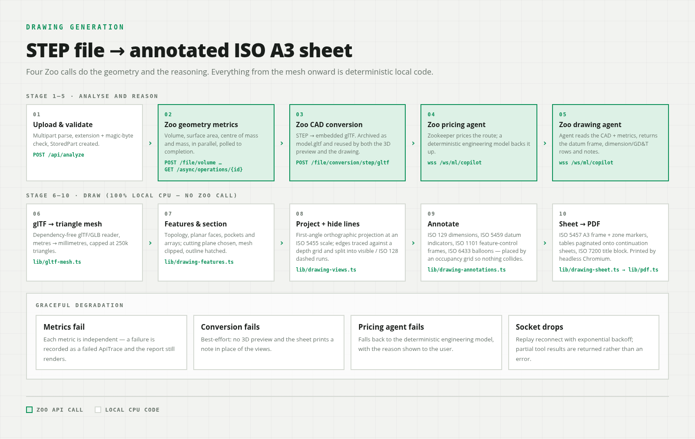

The most involved subsystem, and worth reading as a pipeline:

```text
Zoo /file/conversion/{fmt}/gltf   →  glTF with embedded buffers
  lib/gltf-mesh.ts                →  welded triangle mesh in mm (glTF metres × 1000),
                                     bounding box; models over 250k triangles rejected
  lib/drawing-features.ts         →  coplanar planar faces, recessed pockets/slots,
                                     linear pocket arrays (reachability-ray tested)
  lib/drawing-views.ts            →  first-angle front / left / top / isometric views,
                                     section A-A, silhouette + hidden-line removal,
                                     ISO 5455 scale chosen to fit the 239 × 276 mm area
  lib/drawing-annotations.ts      →  ISO 129 dimensions (outward arrows below 7 mm),
                                     ISO 5459 datum indicators, ISO 1101 feature control
                                     frames (14 characteristics drawn as SVG paths),
                                     ISO 6433 balloons, collision-avoiding placement
  lib/drawing-sheet.ts            →  ISO 5457 A3 landscape sheet (420 × 297 mm), zone
                                     markers, ISO 7200 title block, datum + dimension
                                     tables, continuation sheets when rows overflow
  api/drawings/pdf                →  lib/pdf.ts → headless Chromium → PDF (1:1, A3)
```

Everything in this pipeline downstream of the glTF conversion is deterministic
local code with no Zoo call. That split is deliberate: the agent is used for the
judgement call a human draftsman makes (*which faces are the datums, what
tolerances does this feature need*), and never for the geometry, which must be
reproducible.

Two details worth noting. The datum letters and tolerance rows drawn on the sheet
are the ones the Zoo copilot chose, and each balloon number **is** the table row
number — so the sheet and the inspection table cannot drift apart. And the GD&T
characteristic symbols are drawn as SVG paths rather than glyphs, because the
print container has no font containing the GD&T block.

Honest scope of the drafting code: it recognises planar faces, recessed pockets
and linear pocket arrays. It does **not** fit cylinders, so there is no hole,
bore, thread, fillet or diameter recognition; there are no per-feature centre
lines; there is exactly one section, always lettered A; and the title-block
revision field is fixed at `00`.

---

## Engineering guardrails

Because this handles other people's CAD files and other people's API tokens:

**Request boundaries** — same-origin verification on every state-changing route;
bounded streaming readers (32 KiB JSON, 16 KiB for the demo endpoint, 32 MiB
multipart with 20 MiB CAD / 10 MiB drawing sub-limits); extension allowlist plus
magic-byte content checks; unknown RFQ fields rejected rather than ignored;
per-route rate limits and a per-user single-flight lock on analysis.

**Authentication** — Authorization Code with S256 PKCE and state; AES-256-GCM
sealed `HttpOnly` cookies with a 30-day absolute cap; the workspace ID always
derived from the session, never from a request body.

**Secrets at rest** — the user's personal Zoo API token and OpenAI key are
sealed with the same AES-256-GCM envelope before they touch the store, and the
API only ever reports `hasZooApiToken` / `hasAiApiKey` booleans back to the
browser.

**Provider boundaries** — fixed outbound hosts; byte ceilings and timeouts on
every Zoo and OpenAI response; geometry values range-checked; AI prices and lead
times clamped to 0.25×–4× the deterministic baseline; AI-authored HTML stripped
of scripts and inline handlers and rendered in a sandboxed iframe (and with
JavaScript disabled in the PDF renderer).

**Storage** — per-user object quotas (250 results, 250 reports, 250 parts,
200 folders, 100 machines, 100 drawings, 20 attachments per result), a 64 MiB
store ceiling, blob-key traversal validation, and atomic writes.

**Container** — non-root `1000:1000`, `no-new-privileges`, all capabilities
dropped, no published host port, log rotation, healthcheck.

Full control set and residual risks: [docs/SECURITY.md](docs/SECURITY.md) and
[docs/SECURITY_REVIEW.md](docs/SECURITY_REVIEW.md). Numeric limits per endpoint:
[docs/API.md](docs/API.md#limits-at-a-glance).

---

## Known limitations

Stated plainly, because a decision-support tool that overstates its evidence is
worse than none:

- **Prices are planning ranges, not quotations.** No stock availability, MOQs,
  tooling purchases, scrap, freight, margin or currency movement.
- **Zoo library projects give context, not geometry.** A live analysis still
  needs a local CAD upload.
- **Uploaded drawings are checked for presence and file signature only.** No OCR,
  no dimension extraction, no CAD-vs-drawing reconciliation.
- **The generated drawing table is a proposal.** The copilot's datums and
  tolerances are not verified against process capability or gauging, and the
  drawing views are projected from a *tessellated* mesh, so curved edges are
  polyline approximations. An engineer must review the sheet before release.
- **Feature recognition is mesh-based and heuristic.** It finds planar faces,
  pockets and pocket arrays — not holes, threads, fillets or diameters. Wall
  thickness, tool access, bend feasibility and tolerance stack-up are not
  analysed. Models above 250 000 triangles are refused rather than truncated.
- **Factory modelling is coarse.** Process, materials, hourly rate and setup
  minutes only — no work envelope, axis count, tooling inventory or calendar.
  "Available in factory" means capability match, not scheduling approval.
- **Single replica.** Rate limits, single-flight locks and the JSON driver's
  mutation queue are all process-local.
- **Archive and trash are reversible states,** and items in them still count
  toward quota until the trash is explicitly emptied. Permanent deletion is a
  separate deliberate action, not a side effect of trashing.
- **English only,** with fixed date and EUR presentation.

The complete and deliberately candid list:
[docs/LIMITATIONS.md](docs/LIMITATIONS.md).

---

## Documentation

Start at the [documentation index](docs/INDEX.md).

**For judges**

- [Zoo API notes & bug reports](docs/ZOO_API_NOTES.md) — every contract we
  exercised, every limitation we hit, with reproductions
- [Judging map](docs/JUDGING.md) — where each criterion is demonstrated
- [Contest demo script](docs/DEMO.md) — the walkthrough, with a fallback path
- [Product specification](docs/PRODUCT.md) — users, workflows, evidence model

**For engineers**

- [Architecture](docs/ARCHITECTURE.md) — components, trust boundaries, sequences
- [Internal HTTP API](docs/API.md) — all 23 routes with methods, params, limits
- [Data model](docs/DATA_MODEL.md) — entities, invariants, lifecycle, retention
- [Zoo Agent contract](docs/ZOO_AGENT.md) — request, validation, merge, fallback
- [Testing](docs/TESTING.md) · [Code quality](docs/CODE_QUALITY.md) ·
  [Contributing](docs/CONTRIBUTING.md)

**For operators**

- [OAuth setup](docs/OAUTH_SETUP.md) · [Deployment](docs/DEPLOYMENT.md) ·
  [Operations](docs/OPERATIONS.md)
- [Security](docs/SECURITY.md) · [Security review](docs/SECURITY_REVIEW.md)
- [Design system](docs/DESIGN_SYSTEM.md) · [Limitations](docs/LIMITATIONS.md) ·
  [Roadmap](docs/ROADMAP.md)

## Licence

MIT — see [LICENSE](LICENSE).

---

<sub>Built for the [Zoo API Makeathon](https://zoo.dev/events/api-makeathon), July–August 2026.
Submission materials — demo video, screenshots and diagrams — live in [`contest/`](contest/).
Datums and tolerances are proposed by an AI agent and must be reviewed by a qualified
engineer before a drawing is released.</sub>
