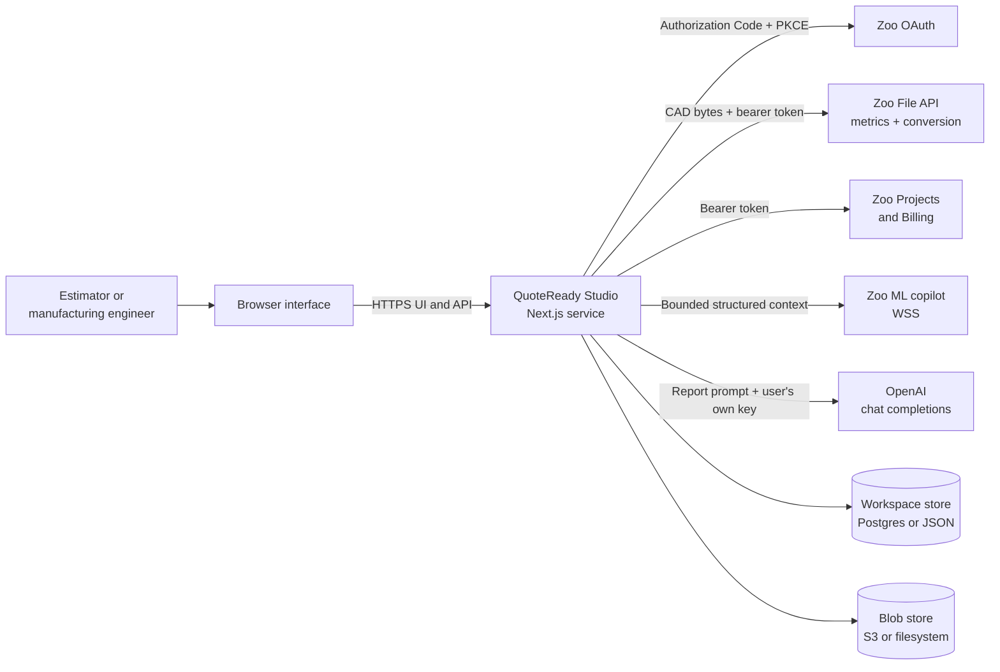
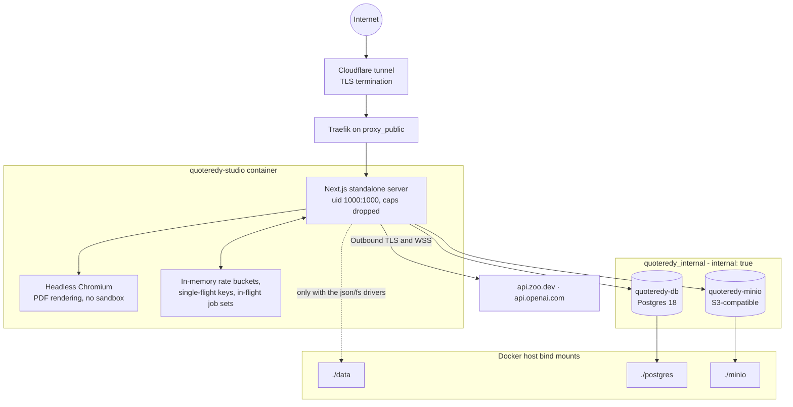
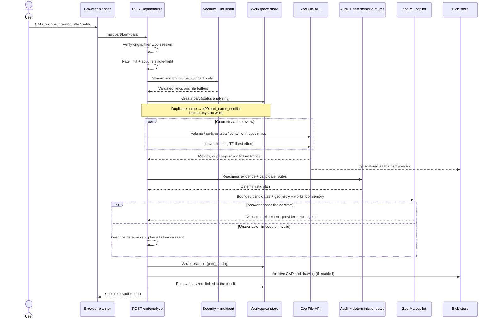
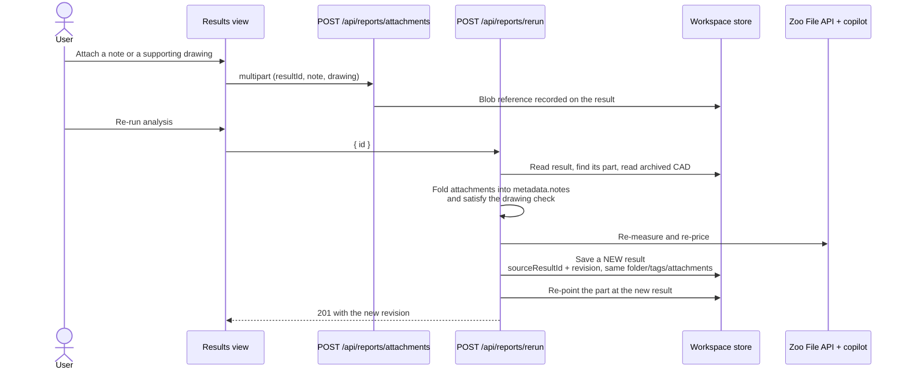
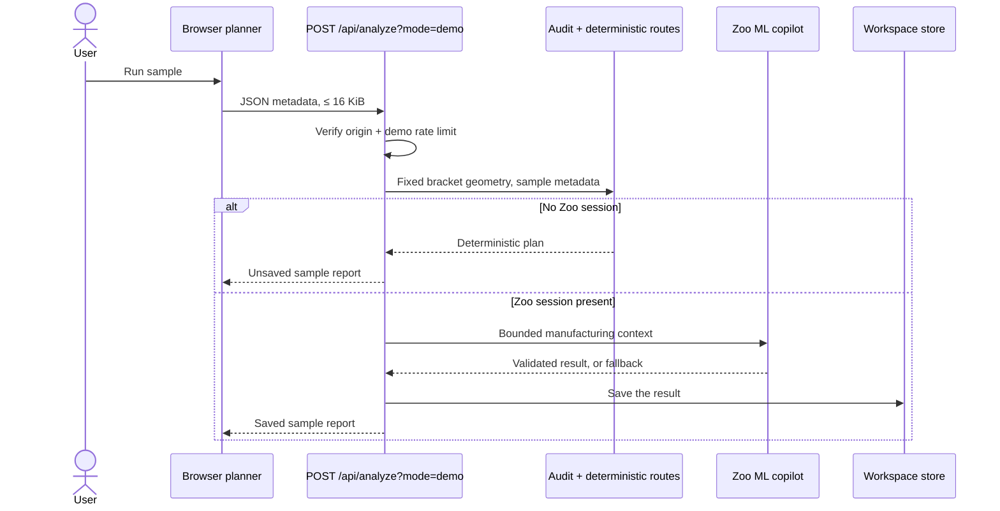

# Architecture

## Architectural goals

QuoteReady Studio is deliberately small enough to audit yet complete enough to
demonstrate an end-to-end manufacturing workflow. The architecture prioritises:

- a clear boundary between browser, application, providers and persistent data;
- deterministic behaviour computed *before* any AI refinement;
- explicit validation at every external boundary;
- graceful partial failure with visible provenance;
- one deployable container with no published host port;
- a migration path from contest-scale JSON persistence to a transactional data
  layer — already taken: the Postgres driver is the compose default.

## Repository shape

An npm-workspaces monorepo with three packages:

| Workspace | Package | Contains |
|---|---|---|
| `apps/web` | `@quoteredy/web` | Next.js 16 app router: the nine authenticated views, the login gate, 23 route handlers, and the web-layer glue (Zoo adapters, multipart, request security, the drawing pipeline, PDF rendering) |
| `packages/core` | `@quoteredy/core` | Pure domain logic with no web or storage dependency: types, readiness audit, deterministic manufacturing model, Zoo pricing contract, per-user workshop memory, the ML copilot websocket client |
| `packages/storage` | `@quoteredy/storage` | Persistence adapters: the domain store, two workspace drivers (JSON, Postgres) and two blob drivers (filesystem, S3-compatible) |

The split exists so the domain rules and the persistence invariants can be tested
without an HTTP server or a browser — which is where most of the 118 tests live.

## System context



The browser talks only to the QuoteReady Studio service. The server owns every
provider call and every persistence operation; no Zoo or OpenAI token ever
reaches the browser. OAuth establishes identity; the File API measures uploaded
CAD and converts it to glTF; the Projects and Billing endpoints back the library
and the usage badge; the ML copilot receives bounded structured context; OpenAI is
only contacted when the user has supplied their own key and enabled detailed
reports.

## Deployment and trust boundaries



Public traffic is terminated upstream and reaches the container only through
Traefik's external network. Only `quoteredy-studio` joins `proxy_public`; the
database and object store sit on an `internal: true` network with no route out.
The Node process runs unprivileged with all capabilities dropped. Rate,
concurrency and job coordination are process-local. The only outbound directions
are server-initiated TLS/WSS to Zoo and OpenAI.

### Trust-boundary controls

| Boundary | Untrusted input | Primary controls |
|---|---|---|
| Browser → application | Origin, JSON, multipart fields and files, identifiers | Same-origin checks, session authentication, bounded streaming readers, field allowlists, per-route rate limits, single-flight |
| OAuth redirect → session | Code, state, token and profile responses | S256 PKCE, state equality, 10-minute transaction, response ceilings, AES-256-GCM sealed cookies |
| Application → Zoo File API | CAD bytes, source format, density | Fixed host, bearer token, extension allowlist, magic-byte checks, per-call timeouts, one shared 45 s deadline |
| Zoo File API → application | Operation status, metric values, glTF | 128 KiB / 48 MiB response ceilings, JSON shape check, finite/range validation, bounded polling, 250 k-triangle mesh cap |
| Application ↔ Zoo ML copilot | Prompt context and streamed answer | Bounded RFQ input, 16 MiB frame cap, 256 KiB cumulative text cap, per-prompt budgets (80 s / 5 min / 120 s), stall watchdog, strict JSON response contract |
| Application ↔ OpenAI | Report prompt and generated HTML | User-supplied key only, 180 s timeout, 2 MiB response ceiling, script/handler stripping, 500 KiB storage cap, sandboxed iframe rendering |
| Application → Chromium | Generated HTML | JavaScript disabled on the page, 30 s content timeout, private temp profile per browser launch |
| Application → workspace store | Workspace mutations | Session-derived user ID, object quotas, 64 MiB store ceiling, serialised mutation queue (JSON) or row lock (Postgres) |
| Application → blob store | Blob keys and bytes | Key pattern + traversal validation, filename sanitisation, path containment check on the filesystem driver |

## Runtime components

### Browser shell

`apps/web/components/platform-shell.tsx`, mounted by the
`apps/web/app/(platform)/layout.tsx` layout, owns navigation, session state,
workspace refresh, the Zoo usage badge, the mobile drawer and user-visible
notices. Nine routed views:

| Code | Route | View |
|---|---|---|
| 01 | `/` | Overview |
| 02 | `/planner` | Planning |
| 03 | `/library` | Zoo library |
| 04 | `/parts` | Parts |
| 05 | `/drawings` | Drawings |
| 06 | `/results` | Results |
| 07 | `/reports` | Reports |
| 08 | `/factory` | My factory |
| 09 | `/settings` | Settings |

`apps/web/app/login/page.tsx` is the gate: every platform view requires a Zoo
session.

### Planner

`apps/web/components/planner.tsx` renders the RFQ form and the interactive
report. Its state — form values, selected files, the running request, the result
— lives in the module store `apps/web/lib/planner-store.ts`, so an analysis keeps
running and stays visible across route changes until the explicit **New plan**
reset. The store also enforces the client-side required-field gate that mirrors
the server rule in `apps/web/lib/rfq.ts`. A selected Zoo project is planner
context only; a local CAD file remains required for live geometry.

### Route handlers

Handlers under `apps/web/app/api/` perform authentication, origin checks, request
limits, orchestration and response mapping. Business rules live in
`apps/web/lib/` and the two packages so they can be tested without an HTTP
server. Every handler pins `runtime = "nodejs"` — the code depends on
`node:crypto`, `busboy`, `pg`, `ws` and `puppeteer-core`.

### Background generation jobs

Two long-running AI flows run as fire-and-forget server jobs. Both always write
their outcome back into the workspace, so navigating away never loses them, and
the owning page polls while an item is pending:

| Job | Module | Lifecycle | Stale after |
|---|---|---|---|
| AI detailed report | `apps/web/lib/report-generation.ts` → `report-ai.ts` | `generating` → `ready` \| `failed` (bounded `error`) | 10 min |
| Zoo drawing table | `apps/web/lib/drawing-generation.ts` | `generating` → `ready` \| `failed` (bounded `error`) | 15 min |

Both guard against duplicate execution with a module-level in-flight set keyed
`{userId}:{itemId}`, and neither ever throws — a failure is persisted as
`failed`, so the UI always leaves the `generating` state.

The third AI flow, **drawing chat**, is deliberately synchronous: it is text-only
(no CAD attached) with a 120 s budget, wrapped in a per-drawing single-flight, so
the user gets a conversational turn rather than a job to poll.

### Boundary helpers

- `apps/web/lib/request-security.ts` — same-origin verification, byte-bounded
  JSON and upstream readers, capped and swept in-memory rate buckets, per-key
  single-flight.
- `apps/web/lib/multipart.ts` — streaming Busboy parser with total, per-file,
  per-field and part-count limits.
- `apps/web/lib/rfq.ts` — RFQ field allowlist, value bounds, format detection and
  magic-byte content checks.
- `apps/web/lib/oauth.ts` — PKCE, state generation, AES-256-GCM cookie envelopes
  (also reused to seal the user's stored secrets), redirect-origin construction.
- `apps/web/lib/api-auth.ts` — `requireSession()`, which turns a missing or
  unrefreshable session into a clean `401` rather than a `500`.

### Manufacturing core (`packages/core`)

- `src/audit.ts` — evidence checks, score deductions, status, clarification
  questions, assumptions.
- `src/manufacturing.ts` — the five deterministic route candidates, their
  operations, factory matching, and benchmark-or-configured cost inputs.
- `src/pricing.ts` — the Zoo pricing prompt, response validation, constrained
  merge and deterministic fallback.
- `src/user-memory.ts` — per-user workshop memory distilled from past results.
- `src/zoo-copilot.ts` — the ML copilot websocket client: frame reducer, MsgPack
  replay decoding, reconnect state machine, diagnostics.
- `src/materials.ts`, `src/parts.ts` — material catalogue; part-identity,
  collision and supersede rules.

### Zoo adapters (`apps/web/lib`)

- `zoo-auth.ts` — token exchange, profile read, refresh, absolute session age,
  revocation, session cookie.
- `zoo.ts` — File API metric requests, async operation polling, metric
  validation, partial-failure traces.
- `zoo-model.ts` — CAD→glTF conversion and preview archival.
- `zoo-projects.ts` — personal-token resolution with ownership verification, and
  the human-readable explanation for an upstream `403`.

### Drawing pipeline (`apps/web/lib`)

The largest subsystem, and entirely CPU-side — the runtime container has no GPU
or WebGL stack:

```mermaid
flowchart TD
    Z[Zoo /file/conversion/&#123;fmt&#125;/gltf] --> G[gltf-mesh.ts<br/>welded triangle mesh in mm<br/>≤ 250k triangles]
    G --> F[drawing-features.ts<br/>planar faces, pockets,<br/>pocket arrays]
    F --> V[drawing-views.ts<br/>first-angle views, section A-A,<br/>hidden lines, ISO 5455 scale]
    T[Copilot drawing table<br/>datums + tolerance rows] --> V
    V --> A[drawing-annotations.ts<br/>ISO 129 dimensions, ISO 5459 datums,<br/>ISO 1101 frames, ISO 6433 balloons]
    A --> S[drawing-sheet.ts<br/>ISO 5457 A3 sheet,<br/>ISO 7200 title block, tables]
    T --> S
    S --> P[pdf.ts → headless Chromium]
    P --> O[A3 landscape PDF]
```



Two properties are worth calling out. The annotator resolves each table row to a
geometric feature by keyword and gives it a balloon whose number **is** the table
row number, so the views and the inspection table cannot disagree. And the whole
path degrades: a part with no usable glTF still produces a sheet, with the reason
printed in the drawing area and scale `NTS` in the title block.

### PDF rendering

`apps/web/lib/pdf.ts` drives `puppeteer-core` against the system Chromium
(`PUPPETEER_EXECUTABLE_PATH`, then `/usr/bin/chromium-browser`,
`/usr/bin/chromium`, `/usr/bin/google-chrome`). The browser is a process-wide
singleton, reset on launch failure so the next request retries. Because the
container runs as uid 1000 with all capabilities dropped, the Chromium sandbox
cannot be used; the mitigations are that page JavaScript is disabled, the input
HTML is sanitised upstream, and every directory Chromium writes to is redirected
into a private temp profile (`--user-data-dir`, `--crash-dumps-dir`,
`--disk-cache-dir`, plus `HOME` and the `XDG_*` variables). A deployment without
Chromium answers `503` from the two PDF routes and works normally otherwise.

### Persistence (`packages/storage`)

`WorkspaceStore` holds every domain operation — quotas, ownership rules, folder
validation, route-selection membership, attachment limits, part-name policy — so
both drivers behave identically. A driver only has to provide `read(userId)` and
`mutate(userId, operation)`:

| Driver | Selected by | Mechanism |
|---|---|---|
| `JsonWorkspaceDriver` | `QUOTEREADY_STORAGE_DRIVER=json` (code default) | One `data/platform.json` holding a versioned `users` map. Mutations queue behind one process-wide promise, read and validate the whole store, apply one change, enforce quotas, serialise, write a mode-`0600` temp file, and atomically rename. |
| `PostgresWorkspaceDriver` | `QUOTEREADY_STORAGE_DRIVER=postgres` (compose default) | One JSONB document per user in `quoteready_workspaces` (schema auto-created). Mutations run `SELECT … FOR UPDATE` inside a transaction, so multiple application replicas stay correct. |

Blob storage is selected independently by `QUOTEREADY_BLOB_DRIVER`:
`FsBlobStore` (atomic writes under `<dataDir>/blobs`, containment-checked paths)
or `S3BlobStore` (AWS, MinIO, R2, Garage — path-style addressing by default).
Both validate the key against a strict pattern and reject traversal before it
reaches a backend.

Blob key layout:

```text
users/{userId}/parts/{partId}/model.gltf                       glTF preview
users/{userId}/parts/{partId}/source/{fileName}                archived part CAD
users/{userId}/reports/{reportId}/{fileName}                   analysed CAD + drawing
users/{userId}/reports/{reportId}/attachments/{uuid}/{fileName}  result attachments
```

The random UUID segment on attachments keeps two uploads of the same file name
apart and lets a re-run share the bytes of the attachments it carries forward.

## Live analysis sequence



Live mode authenticates *before* reading the upload, admits one analysis per user,
streams the multipart package under fixed limits, runs up to four geometry
operations plus a conversion in parallel, builds deterministic evidence and
routes, optionally accepts a constrained refinement, saves the result, and returns
it. A failed metric becomes a trace, never a fabricated value. Any failure after
the part record exists marks the part `failed`.

## Re-run and revision sequence



A re-run never mutates history. Because the part is re-pointed at the newest
result, an older revision finds its 3D part by walking the `sourceResultId` chain
(`apps/web/lib/result-context.ts`).

## Sample analysis sequence



Sample mode never sends geometry to the File API, and its metrics are labelled as
fixed sample evidence, never as Zoo evidence.

## Geometry failure behaviour

Metric calls share one 45 s deadline and run concurrently. Each may return a
value or a failed trace, and the report is built either way:

- missing volume fails the readable-CAD check and blocks readiness;
- missing surface area or centre of mass is displayed as unavailable and stored
  as `null`;
- missing mass for a material with a known density raises a warning;
- no substitute value is ever labelled as Zoo evidence.

## Zoo agent failure behaviour

The deterministic plan is always built first; the copilot is an optional
refinement even when authentication is present. A connection error, timeout,
stall, unreadable stream, oversized output, unknown or duplicate route ID,
invalid summary, non-finite number, unordered price range, out-of-bound price or
out-of-bound lead time all activate the deterministic plan with a stored
`fallbackReason`. See [Zoo Agent](ZOO_AGENT.md) for the complete contract and
[Zoo API notes](ZOO_API_NOTES.md) for the upstream behaviour that makes this
necessary.

## Persistence and consistency behaviour

With the JSON driver, reads wait for pending mutations and then parse the whole
store; writes are serialised inside one Node process, and the
temp-file-plus-rename pattern prevents a reader from observing a partial file.
With the Postgres driver, each mutation takes a row lock inside a transaction, so
concurrent writers — including multiple replicas — serialise correctly. Structure,
object counts and the 64 MiB serialised size are all checked before commit.

Consequences either way:

- a crash before commit leaves the previous state intact;
- a failed quota check does not commit the mutation;
- a corrupt or oversized store is a hard operational error, not a silent reset;
- archived and trashed items remain stored and count toward quota;
- **rate limits, single-flight keys and background-job in-flight sets are still
  process-local**, so multi-replica operation needs shared coordination even on
  Postgres.

## Security and availability invariants

1. The server derives workspace identity from the sealed Zoo session, never from
   a request body.
2. Live authentication happens before the request body is consumed.
3. Every request body and every external response has a byte or shape boundary.
4. One user may have only one analysis (or re-run) in flight per process.
5. Provider tokens are never returned by an application endpoint; the user's
   stored Zoo and OpenAI secrets are sealed at rest and reported only as
   booleans.
6. The Zoo copilot cannot create route IDs, replace deterministic operations, or
   move a price or lead time outside 0.25×–4× of the baseline.
7. Every stored recommendation retains its provider provenance and fallback
   reason.
8. AI-authored HTML is stripped of scripts and inline handlers, stored bounded,
   rendered in a sandboxed iframe, and printed with JavaScript disabled.
9. A part is never destroyed by a name collision — it is superseded and kept, so
   older results keep resolving their original geometry.

## Scaling path

The Postgres driver and the S3 blob driver already remove the two hardest
single-node constraints. What remains before multi-replica operation:

- move rate limiting, single-flight and job de-duplication to shared state
  (Redis or Postgres advisory locks);
- move the two background generation jobs to a real queue with retries and a
  visible job console;
- put uploads in short-lived object storage with lifecycle rules;
- add per-user byte accounting on top of the object quotas;
- instrument queue latency, provider latency, quota use and failure rates.

See [Operations](OPERATIONS.md), [Security review](SECURITY_REVIEW.md) and
[Roadmap](ROADMAP.md).
