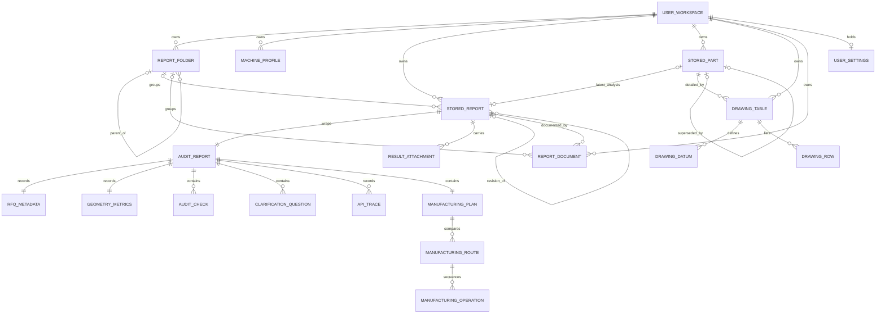
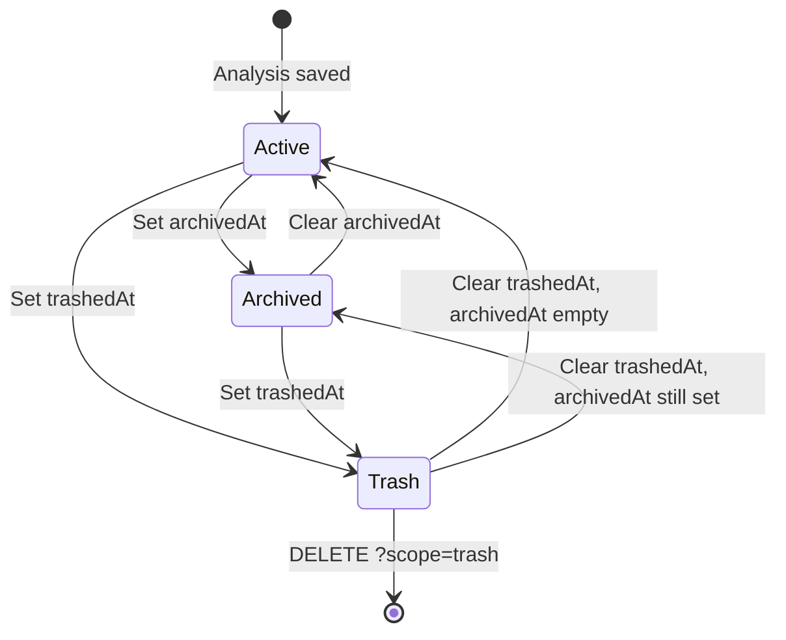
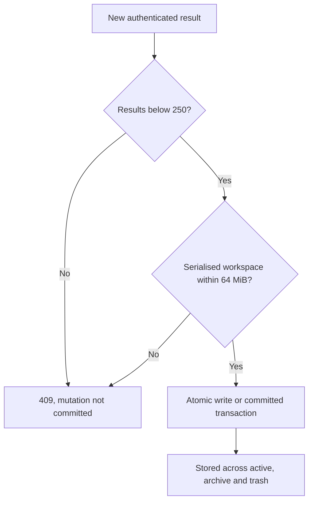

# Data model

## Overview

QuoteReady Studio has two related models:

1. an **analysis model** — the `AuditReport` the planner produces and returns;
2. a **workspace model** — the authenticated per-user container that wraps
   results with lifecycle metadata and also holds folders, machines, parts,
   drawing tables, report documents and settings.

`packages/core/src/types.ts` is the compile-time source of truth for both, and
is consumed by the web app as `@quoteredy/core/types`. Runtime validation lives
at the HTTP and provider boundaries (`apps/web/lib/rfq.ts`,
`apps/web/lib/request-security.ts`, `apps/web/lib/zoo.ts`,
`packages/core/src/pricing.ts`); structural validation of stored data lives in
`packages/storage/src/model.ts` (`validateWorkspaceShape`).

## Entity relationships



One workspace per Zoo user, keyed by the Zoo account ID. It owns six
collections plus a settings object. A folder may have a parent folder and may
group both results and report documents. A stored result wraps a complete audit
report and may carry attachments and a link to the result it was re-run from. A
part points at its latest analysis result, may be detailed by several drawing
tables, and may be superseded by a newer part that took its name.

## Where the data lives

Two independent, environment-selected stores.

### Workspace store — structured records

`QUOTEREADY_STORAGE_DRIVER` picks the driver; the domain rules in
`packages/storage/src/workspace-store.ts` are identical either way.

| Driver | Layout |
|---|---|
| `json` (code default) | One `<data dir>/platform.json` holding `{ "version": 1, "users": { "<zooUserId>": UserWorkspace } }`. Written mode `0600` via temp file + atomic rename, serialised behind one process-wide promise queue. |
| `postgres` (compose default) | Table `quoteready_workspaces (user_id text primary key, data jsonb, created_at, updated_at)`, schema auto-created on first use. One JSONB document per user, mutated under `SELECT … FOR UPDATE` inside a transaction. |

`<data dir>` is `QUOTEREADY_DATA_DIR` or `QUOTE_READY_DATA_DIR`, defaulting to
`./data`; the container sets `/app/data` and bind-mounts `./data`.

Abridged JSON-driver shape:

```json
{
  "version": 1,
  "users": {
    "zoo-user-id": {
      "folders": [],
      "machines": [],
      "reports": [],
      "documents": [],
      "parts": [],
      "drawings": [],
      "settings": null
    }
  }
}
```

### Blob store — binary payloads

`QUOTEREADY_BLOB_DRIVER` picks `fs` (files under `<data dir>/blobs`, atomic
writes, mode `0600`, path-containment checked) or `s3` (any S3-compatible
endpoint — the bundled MinIO, AWS, R2, Garage). Keys must match
`^[A-Za-z0-9][A-Za-z0-9._/-]{0,511}$`, may not contain `..`, and may not end in
`/` (`assertValidBlobKey`); every filename segment passes through
`sanitizeBlobFileName`.

| Key | Contents | Written when |
|---|---|---|
| `users/{userId}/parts/{partId}/model.gltf` | glTF preview from Zoo's conversion API | Always, best effort |
| `users/{userId}/parts/{partId}/source/{fileName}` | Archived part CAD | On `POST /api/reports/part` always; on other uploads when `QUOTEREADY_PERSIST_UPLOADS=true` |
| `users/{userId}/reports/{reportId}/{fileName}` | The analysed CAD and drawing | When `QUOTEREADY_PERSIST_UPLOADS=true` |
| `users/{userId}/reports/{reportId}/attachments/{uuid}/{fileName}` | Result attachments | Always |

The random UUID segment keeps two uploads of the same filename apart and lets a
re-run share the bytes of the attachments it carries forward. Only the **key** is
recorded in the workspace store — never the bytes.

### Store invariants

- `version` must equal `1` and `users` must be an object (JSON driver).
- Every workspace must contain `folders`, `machines` and `reports` arrays;
  `documents`, `parts` and `drawings` are backfilled to `[]` when missing, and a
  non-object `settings` is normalised to `null`.
- A `report.attachments` value that is present but not an array is reset to `[]`
  rather than allowed to break the whole workspace load.
- Documents predating asynchronous generation are normalised to
  `status: "ready"`, `error: null`, `folderId: null`.
- User keys come from the decrypted Zoo session, never from request input.
- Quotas are enforced before every commit (see [Quotas](#quotas)).
- The serialised workspace must not exceed 64 MiB — per user row on Postgres,
  for the whole file on the JSON driver.

## RFQ metadata

`RfqMetadata` records the requirements known at analysis time.

| Property | Meaning | Runtime normalisation |
|---|---|---|
| `partName` | Part number or human name | Trimmed, ≤ 140 characters |
| `process` | Requested process, or `unknown` to compare all routes | Allowlisted process ID |
| `material` | Material grade | Allowlisted material ID |
| `quantity` | Production quantity | `null`, or a safe integer 1–1 000 000 |
| `units` | Authoritative design units | `unknown`, `mm` or `in` |
| `tolerance` | General or feature tolerance text | Trimmed ≤ 160 characters; empty becomes `ISO 2768-m` |
| `finish` | Coating, treatment or finish text | Trimmed ≤ 160 characters; empty becomes `As Machined` |
| `notes` | Customer and handling notes | Trimmed ≤ 2 000 characters |
| `hasDrawing` | Whether a supported drawing was attached | Derived by the server; never accepted as input |
| `sourceProject` | Optional `{ id, name }` traceability context from the Zoo library | Both fields required together; ≤ 200 / ≤ 160 characters |

The model stores drawing *presence*, not drawing bytes or interpreted drawing
content. On a re-run, `notes` is rewritten to include an
`Additional context attached by the user:` block derived from the result's
attachments, and `hasDrawing` becomes true when a PDF/PNG/JPEG attachment is
present (`apps/web/lib/result-context.ts`). The block is regenerated rather than
appended, so repeated re-runs never stack duplicates.

## Geometry metrics

`GeometryMetrics` is deliberately nullable so partial Zoo failures stay explicit:

```typescript
interface GeometryMetrics {
  volumeMm3: number | null;
  surfaceAreaMm2: number | null;
  massG: number | null;
  centerOfMassMm: [number, number, number] | null;
}
```

Live values come from the Zoo File API. Sample-mode values are fixed constants
labelled as rule evidence. Mass is requested only when the selected material has
a known density. A `null` always means "not measured", never "zero".

## Audit report

`AuditReport` is the complete decision artefact.

| Group | Properties |
|---|---|
| Identity | optional `id` (matches the `StoredReport` id once saved), `mode` (`zoo` \| `demo`), `generatedAt` |
| Readiness | `score` (0–100), `status` (`ready` \| `review` \| `blocked`), `summary` |
| Source file | `file.name`, normalised `file.format`, `file.sizeBytes` |
| Requirements | `metadata` (`RfqMetadata`) |
| Geometry | `metrics` (`GeometryMetrics`) |
| Evidence | `checks`, `questions`, `assumptions`, `apiTrace` |
| Production decision | `manufacturingPlan` |

`BaseAuditReport` is `AuditReport` without `id` and `manufacturingPlan` — the
shape the audit engine returns before pricing runs.

### Audit check

Each `AuditCheck` has a stable `id`, `label`, `status`
(`pass` \| `warning` \| `fail`), `detail`, `evidence`, `source` and `deduction`.
`source` is the provenance marker the whole product rests on:

- `user` — declared RFQ information;
- `zoo` — a metric returned by a live Zoo operation;
- `rule` — fixed sample evidence or deterministic inference.

The eight scored checks and their deductions:

| Check ID | Missing-case status | Deduction |
|---|---|---:|
| `cad-readable` | fail | 30 |
| `units` | fail | 18 |
| `material` | fail | 16 |
| `tolerance` | warning | 12 |
| `quantity` | warning | 10 |
| `drawing` | warning | 8 |
| `finish` | warning | 6 |
| `mass` | warning (only when density was known) | 5 |
| `process` | always `pass` | 0 |

`process` is deliberately not a deduction: leaving the target process open is a
fully supported flow that switches the estimate into route-comparison mode.

`score = max(0, 100 - Σ deductions)`. Any `fail` makes the report `blocked`;
otherwise any `warning` makes it `review`; otherwise `ready`. At most five
clarification questions are returned, in audit-rule order.

### API trace

Each `ApiTrace` records `endpoint`, `status` (`completed` \| `failed` \|
`skipped`), `durationMs`, an optional `operationId` and an optional bounded
`detail`. This is what lets a report distinguish unavailable geometry from
fabricated certainty months later.

## Manufacturing plan

`ManufacturingPlan` carries `provider` (`zoo-agent` \| `deterministic`),
`providerLabel`, an optional `fallbackReason`, `recommendedRouteId`, an optional
`routeSelectedByUser` flag, `summary`, `generatedAt` and the route array.

Each `ManufacturingRoute` stores a stable `id` and `name`, `description`,
`suitability` (0–100), `availableInFactory`, ordered `operations`, a
`PriceEstimate` (`currency: "EUR"`, `minimum`, `expected`, `maximum`,
`confidence` 0–1), `leadTimeHours`, `reasons` and `risks`. Each
`ManufacturingOperation` has `id`, `name`, `process`, `setupMinutes`,
`cycleMinutes` and `detail`.

The five deterministic route IDs are `cnc-from-billet`, `cnc-turned`,
`additive-finish`, `sheet-metal` and `laser-bend-cnc`.

The Zoo agent may replace the recommendation, the plan summary, a route's
description, its price range and confidence, lead time, reasons and risks — only
after validation. Route IDs and names, suitability, factory availability and the
whole operation sequence stay deterministic. See [Zoo Agent](ZOO_AGENT.md).

`routeSelectedByUser` is set when a user picks a route by hand through
`PATCH /api/reports`, and later feeds the per-user workshop memory sent to the
pricing agent.

## Stored report (an analysis result)

`StoredReport` adds workspace lifecycle metadata around an `AuditReport`:

| Field | Meaning |
|---|---|
| `id` | Also written into `report.id`, so UI and API references agree |
| `title` | `{part}_{YYYY-MM-DD}` with the lowest free `_NN` suffix, ≤ 140 characters |
| `folderId` | Nullable folder placement |
| `report` | The complete `AuditReport` |
| `tags` | Optional, ≤ 10 entries of ≤ 30 characters |
| `attachments` | Optional `ResultAttachment[]` |
| `sourceResultId` | Optional — the result this one was re-run from |
| `revision` | Optional 1-based re-run counter |
| `archivedAt`, `trashedAt` | Nullable lifecycle timestamps |
| `createdAt`, `updatedAt` | ISO timestamps |

`tags`, `attachments`, `sourceResultId` and `revision` are written **only when
they apply**, so a plain first-run analysis produces exactly the record shape it
always produced. Readers must therefore use `attachments ?? []` and treat a
missing `revision` as "first run".

### Result attachment

```typescript
interface ResultAttachment {
  id: string;
  kind: "file" | "note";
  text: string;           // note body, or the caption given to an uploaded file
  fileName: string;       // empty on a pure note
  mediaType: string;      // empty on a pure note
  sizeBytes: number;      // 0 on a pure note
  blobKey: string | null; // null on notes
  createdAt: string;
}
```

At most 20 per result; `text` is capped at 4 000 characters. An attachment whose
media type or extension is PDF/PNG/JPEG counts as the RFQ's supporting drawing.

### Revision lineage

A re-run stores a **new** `StoredReport` carrying the source's `folderId`, `tags`
and attachment references (blobs are shared, not copied), linked back through
`sourceResultId` with `revision = (source.revision ?? 0) + 1`. The part is
re-pointed at the new result, so `part.reportId` always names the latest analysis
of that CAD file, and an older revision finds its part by walking the chain
(`resultRevisionIds` / `findResultPart` in `apps/web/lib/result-context.ts`).

Deleting an attachment removes its bytes only when no other result still
references the same `blobKey`.

## Stored part

`StoredPart` tracks an uploaded CAD file across its analysis.

| Field | Meaning |
|---|---|
| `id`, `name`, `fileName`, `format`, `sizeBytes` | Identity |
| `status` | `uploaded` \| `analyzing` \| `analyzed` \| `failed` |
| `source` | `analysis` (uploaded through the planner) or `zoo-upload` (pushed to the Zoo library) |
| `reportId` | The latest analysis result generated from this part, or `null` |
| `zooProjectId` | The Zoo draft project created from this part, or `null` |
| `modelBlobKey` | glTF preview blob key |
| `cadBlobKey` | Archived source CAD blob key |
| `supersededAt`, `replacedById` | Set when a confirmed overwrite handed this part's name to a newer record |
| `createdAt`, `updatedAt` | ISO timestamps |

### Part identity and supersession

A part name is the handle everything downstream is named after, so two *visible*
parts may never share one (`packages/core/src/parts.ts`). Names collide when they
differ only in surrounding whitespace or letter case.

`savePart` and `updatePart` take a conflict policy:

| Policy | Behaviour |
|---|---|
| `allow` | Keep both records — the historical default, still used by the best-effort part record created for a Zoo library upload |
| `reject` | Throw `PartNameConflictError`, which the route turns into a `409` with `code: "part_name_conflict"` |
| `supersede` | The confirmed overwrite: the colliding part gets `supersededAt` and `replacedById` |

A superseded part disappears from the parts list, the pickers and future
collision checks, but the record and **all of its blobs are kept**, so results,
drawings and reports already generated from it keep resolving to the original
geometry. On `POST /api/analyze` the supersede is applied only *after* the new
analysis succeeds, so a failed run never hides the part the user still depends on.

`parts` is a rolling log: when the 250-part cap is reached, the oldest part that
is not currently `analyzing` is evicted so an upload never fails on quota.

### Deprecated fields

`kclCode`, `kclStatus`, `kclError`, `kclSource` and `kclCheckedAt` are marked
`@deprecated` on `StoredPart`. The CAD→KCL conversion feature was removed
(see [Zoo API notes](ZOO_API_NOTES.md#file-1--mlconvertproprietary-to-kcl-stays-403-even-with-a-personal-api-token));
nothing reads or writes them any more. They are declared purely so records
written before the removal keep type-checking, and they are the only intentional
legacy in the model.

## Drawing table

`DrawingTable` is the datum-and-tolerance dossier the Zoo copilot produces for a
part, and the annotation source for the ISO A3 drawing sheet.

| Field | Meaning |
|---|---|
| `id`, `partId`, `partName`, `fileName` | Identity and part link |
| `name` | Sequential `{part}_NN` label; absent on records predating sequential naming, which fall back to `partName` |
| `status` | `generating` \| `ready` \| `failed` |
| `error` | Bounded failure detail when `failed` |
| `units` | Usually `mm`, ≤ 10 characters |
| `generalTolerance` | e.g. `ISO 2768-m` |
| `datums` | `DrawingDatum[]` — `label` (A, B, C…, ≤ 3 chars), `feature`, `reason` |
| `rows` | `DrawingRow[]` — `id`, `feature`, `nominal`, `tolerance`, `datums` (e.g. `A\|B`), `kind` (`dimension` \| `gdt`), `note` |
| `notes` | Free-text sheet notes |
| `createdAt`, `updatedAt` | ISO timestamps |

Every field is bounded when the agent's JSON answer is parsed: at most 6 datums,
40 rows and 10 notes, each text field truncated to 200 characters, the datum
reference to 20. Row IDs are regenerated on every parse, including on each
drawing-chat turn, so they are stable only within one version of the table.

Balloon numbers on the drawing sheet are the 1-based index of `rows`, which is
what keeps the views and the dimension table in agreement.

## Report document

`ReportDocument` is an AI-written detailed engineering report; the HTML is the
source of truth.

| Field | Meaning |
|---|---|
| `id` | Identity |
| `resultId` | The analysis result it was generated from, when still present |
| `folderId` | Mirrors the source result's folder at creation, movable independently afterwards |
| `name` | Sequential `{part}_NN` label; absent on older records, which fall back to `title` |
| `title`, `model` | ≤ 140 / ≤ 80 characters |
| `html` | Standalone sanitised HTML document, ≤ 500 KiB |
| `status` | `generating` \| `ready` \| `failed` |
| `error` | Bounded failure detail when `failed` |
| `tags`, `archivedAt`, `trashedAt`, `createdAt`, `updatedAt` | Lifecycle |

`ReportDocumentSummary` is `ReportDocument` without `html`, plus a computed
`sizeBytes`. It is what every list endpoint returns — the full HTML is only
served by `GET /api/documents/{id}`.

Moving a result to another folder also moves the documents generated from it.

## Machine profile

```typescript
interface MachineProfile {
  id: string;
  name: string;
  process: string;
  hourlyRate: number;
  setupMinutes: number;
  materials: string[];
  enabled: boolean;
  notes: string;
  createdAt: string;
}
```

An empty `materials` array means the machine is eligible for every supported
material; otherwise a route operation matches only when its material ID is in the
array. A route is `availableInFactory` only when every distinct operation process
has an enabled matching machine.

Supported processes: `cnc_milling`, `cnc_turning`, `sheet_metal`, `additive`,
`laser_cutting`, `finishing`.

The model has no calendar, queue, work envelope, axis count, spindle, tooling or
measured cycle-time fields. Those constraints can be captured only in `notes`,
which is human-readable and never used computationally.

## User settings

```typescript
interface UserSettings {
  timezone: string; // default "Europe/Rome"
  currency: string; // default "EUR"
  theme: "system" | "light" | "dark";
  aiReports: { enabled: boolean; model: string }; // default true / "gpt-4o"
}

interface StoredUserSettings extends UserSettings {
  aiApiKeySealed: string | null;
  zooApiTokenSealed: string | null;
}
```

Both secrets — the user's OpenAI API key and their personal Zoo API token — are
sealed with AES-256-GCM (key derived by SHA-256 from
`QUOTE_READY_SESSION_SECRET`, `v1` envelope, random 12-byte IV) *before* they
reach the store. The API only ever returns the public projection, which replaces
them with `hasAiApiKey` and `hasZooApiToken` booleans.

**Operational consequence:** rotating `QUOTE_READY_SESSION_SECRET` does not only
sign users out — it permanently destroys every stored Zoo API token and OpenAI
key, and every user must re-enter theirs.

`timezone` also drives result titles: `{part}_{YYYY-MM-DD}` uses the calendar day
in the user's own timezone (`apps/web/lib/item-naming.ts`), falling back to UTC
if the stored zone is unsupported.

## Naming rules

Two distinct schemes, both in `apps/web/lib/item-naming.ts`:

| Object | Scheme | Collision behaviour |
|---|---|---|
| Drawing tables, report documents | `{stem}_NN` — e.g. `USB_Holder_01` | **Highest** existing suffix + 1, zero-padded to two digits, growing past 99. A deleted item never hands its number to a later one. |
| Analysis results | `{stem}_{YYYY-MM-DD}` — e.g. `USB_Holder_2026-07-30` | Plain if free; otherwise the **lowest** free `_NN` suffix, so deleting `_01` returns that slot. |

The stem is the CAD filename with its extension dropped and every character
outside `[A-Za-z0-9_-]` replaced by an underscore, capped at 80 characters
(`USB Holder.step` → `USB_Holder`). Result titles are compared against every
stored result — archived and trashed included — so restoring an item can never
create a duplicate.

## Report lifecycle

Readiness and library lifecycle are separate dimensions: a result can be `ready`,
`review` or `blocked` while also being active, archived or trashed.



Archive and trash are timestamps, not destructive moves, so clearing the relevant
timestamp restores the item — a trashed result may still carry its archive
timestamp and return to the archived state. Permanent removal is explicit and
separate: `DELETE /api/reports?scope=trash` and
`DELETE /api/documents?scope=trash` empty the respective trash, and
`DELETE /api/reports?folderId=…&mode=purge` permanently removes the results and
documents filed in a folder (`mode=release` moves them back to "all folders"
instead). Child folders are re-parented to the root either way.

## Quotas

`STORE_LIMITS` in `packages/storage/src/model.ts`:

| Object | Limit | On overflow |
|---|---:|---|
| Analysis results | 250 | `409` — archive or delete first |
| Report documents | 250 | `409` — trash one first |
| Parts | 250 | Oldest non-`analyzing` part evicted; `409` only if every part is analysing |
| Drawing tables | 100 | `409` |
| Folders | 200 | `409` |
| Machines | 100 | `409` |
| Attachments per result | 20 | `409` |
| Attachment note text | 4 000 characters | `400` |
| Report-document HTML | 500 KiB | `409` |
| Tags per item / tag length | 10 / 30 characters | `409` |
| Serialised workspace | 64 MiB | `409` |



Result creation is accepted only below the object cap and while the serialised
workspace stays within 64 MiB. Archiving or trashing does not remove the object
and therefore does not release quota — only emptying the trash does. Folder and
machine creation use equivalent checks, and every rejected quota operation maps
to HTTP `409`.

Note the difference in scope: on Postgres the 64 MiB ceiling applies to each
user's row, so it is effectively a per-user byte quota. On the JSON driver it
applies to the whole multi-user file, so one large workspace can exhaust it for
everyone. Blob storage has **no** byte quota under either driver.

## Write algorithm

Every mutation goes through `WorkspaceStore.mutate`, which applies the operation
and then asserts the quotas before the driver commits.

**JSON driver** — waits behind the process-wide mutation promise; reads the whole
file; rejects a file larger than 64 MiB; parses and validates the top-level
structure; selects or creates the session user's workspace; applies one mutation;
enforces quotas; serialises and re-checks the 64 MiB ceiling; writes a
process-specific temporary file with mode `0600`; renames it over
`platform.json`. This provides single-process ordering and atomic replacement —
not database transactions or cross-process locking.

**Postgres driver** — opens a transaction; `SELECT … FOR UPDATE` on the user's
row; validates the stored shape (or starts an empty workspace); applies one
mutation; enforces quotas; serialises and checks the ceiling; `INSERT … ON
CONFLICT DO UPDATE`; commits. Concurrent writers, including multiple replicas,
serialise correctly on the row lock.

Consequences either way: a crash before commit leaves the previous state intact;
a failed quota check does not commit; a corrupt or oversized store is a hard
operational error rather than a silent reset.

## Data not persisted

- CAD and drawing bytes **in the workspace store** — the store holds only blob
  keys. The bytes themselves *are* persisted in the blob store, by default in
  the deployed stack (see [Blob store](#blob-store--binary-payloads)).
- OAuth transaction state after callback or expiry.
- Server-side session or token records — there is no session table.
- In-memory rate buckets, single-flight keys and background-job in-flight sets.
- Raw Zoo copilot stream frames and raw OpenAI responses.

The encrypted browser session cookie holds the access token, optional refresh
token, expiry metadata and a bounded Zoo user profile. See
[Security](SECURITY.md) for handling and [Operations](OPERATIONS.md) for backup
and restore.

## Related documents

- [Internal HTTP API](API.md) — the routes that read and write these objects.
- [Architecture](ARCHITECTURE.md) — where the stores sit in the runtime.
- [Zoo Agent](ZOO_AGENT.md) — what the agent may and may not change in a plan.
- [Security](SECURITY.md) — retention, secrets at rest, and data flow.
