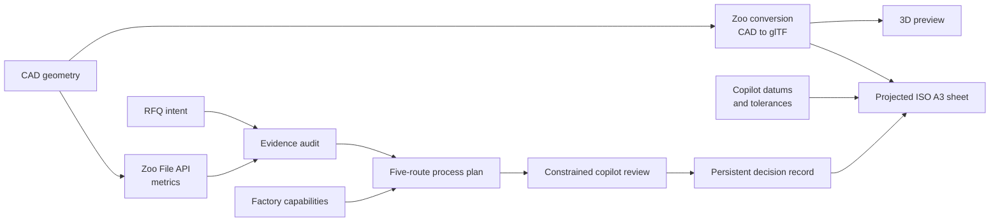

# Contest judging map

## Official scorecard

The [Zoo API Makeathon event page](https://docs.zoo.dev/events/api-makeathon)
defines the following scoring for first, second, and third place:

| Criterion | Weight | What judges evaluate |
|---|---:|---|
| Documentation | 25% | Application setup, behavior, and use cases |
| Documentation notes and bug reporting | 20% | Information that can improve Zoo APIs |
| Technical depth and readability | 20% | Cross-disciplinary depth explained understandably |
| UI/UX | 15% | Quality of interface and user experience |
| Wow: creativity and ingenuity | 20% | Unexpected and compelling use of Zoo APIs |

This page maps each criterion to verifiable product evidence. It does not
replace the official rules or submission requirements.

## One-sentence entry

QuoteReady Studio converts Zoo-measured CAD geometry and incomplete RFQ intent
into a transparent readiness decision, factory-aware multi-step manufacturing
routes, bounded cost and lead-time estimates, a real ISO A3 technical drawing,
and a persistent engineering record.

## 25% — Documentation

### Evidence

| Judge question | Primary evidence | Supporting evidence |
|---|---|---|
| What problem does it solve, and why this way? | [README — The problem / The solution](../README.md#the-problem) | [Product](PRODUCT.md) |
| How does it use Zoo APIs? | [README — How QuoteReady Studio uses Zoo APIs](../README.md#how-quoteready-studio-uses-zoo-apis) | [Zoo API notes](ZOO_API_NOTES.md), [Zoo Agent](ZOO_AGENT.md) |
| How do I set it up from zero? | [README — Setup from zero](../README.md#setup-from-zero) | [OAuth setup](OAUTH_SETUP.md), [Deployment](DEPLOYMENT.md) |
| How do I develop on it? | [README — Development guide](../README.md#development-guide) | [Contributing](CONTRIBUTING.md), [Code quality](CODE_QUALITY.md) |
| How does it work internally? | [Architecture](ARCHITECTURE.md) | [Data model](DATA_MODEL.md) |
| What are the HTTP contracts? | [Internal HTTP API](API.md) | [Security](SECURITY.md) |
| How do I verify it? | [Testing](TESTING.md) | [Demo](DEMO.md) |
| How do I operate and recover it? | [Operations](OPERATIONS.md) | [Deployment](DEPLOYMENT.md) |
| What does it not do? | [Limitations](LIMITATIONS.md) | [Roadmap](ROADMAP.md) |

### Presentation points

- The README answers the three contest requirements directly and in order: the
  problem and the solution rationale, an explicit per-endpoint account of how Zoo
  APIs are used, and setup from zero including the `.env.example` walkthrough and
  first login.
- The documentation set has distinct entry paths for judges, Zoo-integration
  reviewers, engineers, and operators — see [the index](INDEX.md).
- Every mermaid diagram is followed by a prose description, so meaning survives a
  non-rendering viewer.
- Limits, quotas, rate limits and failure behaviour are documented next to the
  happy paths rather than in a separate appendix.
- Where the code default and the Compose default differ, both are stated.
- Commands are copyable and deployment values match the actual Compose file.

### Acceptance proof

A new reviewer should be able to set the project up from the README on a clean
machine, explain the trust boundaries from Architecture, name which Zoo endpoint
produces which artefact, and describe the most important current limitation —
without asking the author.

## 20% — Documentation notes and bug reporting

### Evidence

[Zoo API notes](ZOO_API_NOTES.md) is written as a field report, not a summary. It
is organised in five parts: the endpoint reference as exercised (with the exact
parameters, timeouts and response ceilings we settled on), the findings and bug
reports by API area, documentation feedback ranked by cost, a wish list, and
reproduction material.

Every finding carries a severity from an integrator's point of view, a
reproduction, the product impact, and the workaround actually shipped.

### The findings that cost the most

| ID | Finding | Severity | Consequence for the product |
|---|---|---|---|
| AUTH-1 | Third-party OAuth tokens get HTTP 403 from `/file/*`, `/user/projects` and the ML socket, because the scope set has no projects or ML scope | Blocker | The architecture had to change: every server-side call resolves a per-user **personal API token**, verified for ownership, with the OAuth token only as a fallback |
| ML-1 | The copilot websocket requires an undocumented in-band auth frame; the HTTP header alone yields error frames or a 1006 close | Blocker | Presented exactly like a service outage; the pricing path silently fell back to deterministic until we found it |
| ML-2 | Long copilot turns are killed every 5–6 minutes by a zookeeper recycle, announced as an *error* | Major | Required a full reconnect-with-replay state machine; the error framing misleads any naive client into discarding work the server is still doing |
| ML-3 | A resumed turn stays silent unless the client sends an undocumented `{"type":"system","command":"continue"}`, and even then resumption is unreliable | Major | Found by experiment; we now bank partial output rather than gamble the remaining budget |
| FILE-1 | `/ml/convert/proprietary-to-kcl` returns 403 even with a valid personal API token, with no way to tell beta gating from an auth error | Major | A complete CAD→KCL feature was built and then **removed** |
| ML-6 | The replay frame is MsgPack while every other frame is JSON text | Minor | We wrote a MsgPack decoder purely to read resume history |
| FILE-2 | Conversion output size and the `outputs` key shape are unspecified | Minor | Our first response ceiling truncated valid conversions |
| ML-7 | The text-to-CAD iteration endpoint is deprecated with no clear successor for "edit this existing part" | Minor | We avoided building on it |

Part 3 of the document ranks fourteen documentation gaps by the time each cost,
and — importantly — also records what the API does genuinely well, because that
is the honest half of the feedback.

Every observation is reproduced against the live API, and the client-side
behaviour is pinned by tests in `packages/core/tests/zoo-copilot.test.ts`, so a
future upstream change surfaces as a test failure rather than a silent
regression. Tokens, user IDs, private project names, CAD contents and session
data are excluded; `session_data.api_call_id` is quoted instead.

### Acceptance proof

At least one finding should be reproducible by another integrator from a
synthetic fixture and useful to them even though this application already has a
workaround. AUTH-1 and ML-1 both meet that bar: either one will block any new
third-party Zoo integration on day one.

## 20% — Technical depth and readability

### Cross-disciplinary depth

The entry deliberately spans four disciplines, which is what the criterion asks
for:

**Mechanical engineering.** An ISO-conformant drafting pipeline written from
scratch: first-angle projection with hidden-line removal, a section view with
45° hatching, ISO 129 dimensioning, ISO 5459 datum indicators, ISO 1101 feature
control frames drawn as SVG paths (because no available font contains the GD&T
block), ISO 6433 balloons cross-referenced to the inspection table, ISO 5455
scale selection, and an ISO 7200 title block on an ISO 5457 A3 sheet. Plus a
deterministic cost model over five single- and multi-step routes with
mass, material, quantity, a surface-to-volume complexity proxy, and machine
capability coverage.

**Distributed systems.** Concurrent Zoo geometry operations under one shared
deadline with per-operation partial failure; a websocket client with in-band
auth, keepalive, a stall watchdog, exponential reconnect with replay, a MsgPack
decoder, an explicit resume command, and partial-output harvesting; two
background job flows that always persist their outcome; single-flight admission
control; a store with two interchangeable drivers behind one invariant layer.

**Security engineering.** PKCE with state and encrypted authenticated cookies;
secrets sealed at rest with the same envelope; token-ownership verification
before use; streamed bounded readers on every body and every upstream response;
extension allowlists with magic-byte checks; blob-key traversal validation;
LLM output stripped and sandboxed before rendering; a non-root container with
all capabilities dropped and an internal-only data network.

**Applied AI.** Three distinct copilot prompts with different budgets and
contracts; an AI recommendation that is accepted only inside a 0.25×–4×
deterministic envelope with known route IDs; per-user workshop memory framed
explicitly as a tie-breaking signal that cannot override evidence; a second
provider used only for report authoring, gated on the user's own key.

### Readability evidence

- The monorepo split keeps `packages/core` free of web and storage dependencies,
  which is why the domain layer is the best-tested part of the codebase.
- [Architecture](ARCHITECTURE.md) assigns one responsibility per module and
  diagrams each major sequence.
- [Code quality](CODE_QUALITY.md) records the invariants, the resolved debt and
  the remaining debt honestly.
- [Internal HTTP API](API.md) separates transport, validation, status and
  persistence behaviour for all 23 routes.
- [Data model](DATA_MODEL.md) explains not just the shapes but why optional
  fields are written only when they apply.
- [Testing](TESTING.md) maps each critical invariant to automated or manual
  evidence and states plainly what is untested.
- TypeScript strict mode and zero-warning ESLint are enforced by `npm run check`.

### Acceptance proof

Demonstrate one full data path — upload → Zoo metrics → audit → deterministic
routes → validated agent refinement → stored result → drawing table → ISO A3 PDF
— and one failure path, without skipping a trust boundary in either.

## 15% — UI/UX

### Evidence

- an industrial palette with high-signal green, amber and red, shipped in both a
  dark and a light theme driven from one semantic token set;
- nine numbered views with a clear hierarchy between workspace navigation,
  planner input, analysis state, evidence, routes and reports;
- status is communicated with words and structure, never colour alone;
- one shared control set — search, status filter, tag filter, sortable columns —
  across all four library views, so they are learned once;
- an interactive 3D part preview rendered from Zoo's own conversion output;
- long-running work is a first-class state: `generating` survives navigation,
  `failed` shows the real error with a **Retry**, and actions that need the
  artefact stay disabled until it exists;
- a conversational drawing chat for refining tolerances in plain language;
- destructive and irreversible actions are confirmed — re-using a part name
  raises an explicit overwrite dialog rather than silently replacing data;
- readable type scale with a 12 px floor and 44 px minimum control targets;
- visible keyboard focus, skip link, semantic labels, Escape-close behaviour and
  responsive drawer navigation;
- progressive disclosure: the primary action stays clear while traces, risks and
  assumptions remain available;
- the deterministic fallback is presented as provenance, not as a cryptic error.

The governing rules and audit checklist are in
[Design system](DESIGN_SYSTEM.md).

### Demo proof

Show the planner at desktop and narrow width, keyboard through the primary
controls, toggle the theme, run an incomplete RFQ and show that the interface
explains the next action rather than merely displaying a score — then open a part
in 3D and download its drawing sheet.

### Acceptance proof

A first-time user should identify the input required, start a sample, interpret
`ready`/`review`/`blocked`, compare routes, and find the saved report without
verbal rescue.

## 20% — Wow: creativity and ingenuity

### Product idea

The creative step is not displaying CAD metrics. It is two things: making those
metrics the evidence layer of a manufacturing decision, and then using Zoo's
conversion output for something it was not obviously for — **generating a real
ISO technical drawing**.

In prose: Zoo geometry and user intent meet in an explicit readiness audit, which
drives alternative process chains including hybrid multi-step routes. Local
machine economics changes factory fit. The copilot adds bounded judgment. In
parallel, the same CAD file goes through Zoo's conversion endpoint, and the
resulting glTF mesh becomes both an interactive preview and the geometric source
for a drafted A3 sheet, annotated with the datums and tolerances the copilot
chose.

### The unexpected use of a Zoo API

`POST /file/conversion/{src}/gltf` is documented as a format converter. Used as
intended it gives a preview. Used as a **tessellation service**, it gives a small
web application something it otherwise could not have at all: real geometry to
project. Every line on the drawing sheet — silhouettes, hidden edges, the section
cut, the dimension extents, the balloon anchors — is computed from the triangles
Zoo returned. There is no local CAD kernel anywhere in this project.

Combining that with the ML copilot closes a loop that is usually two separate
jobs: the copilot decides *what should be controlled* (the datum frame and the
tolerance rows) and the projection decides *where to draw it*, with the balloon
numbers and the table rows sharing one index so the sheet and the inspection
table cannot disagree.

### Distinctive elements

- an unknown target process is a supported starting point, not a dead end;
- alternatives include hybrid manufacturing rather than one guessed process;
- factory configuration changes route feasibility and economics;
- every report distinguishes measurement, declaration, rule, recommendation and
  assumption;
- AI refinement can improve the result but cannot escape deterministic
  engineering bounds — and where no honest bound exists, as with datums, there is
  deliberately no fallback and the failure is shown instead;
- a re-run creates a linked revision instead of overwriting history, and an
  overwritten part is hidden rather than destroyed so older results still resolve
  their original geometry;
- failure is a safe product state with a complete baseline plan.

### Acceptance proof

Use one part to compare at least three materially different routes, explain why
the recommended route changed, then open the same part's drawing sheet and point
out that its views came from a Zoo conversion and its tolerances from the Zoo
copilot — with the persisted record tying both to traceable measurements.

## Zoo Team Pick narrative

The Team Pick has no fixed formula on the event page. The strongest narrative
is a credible future platform built around meaningful Zoo usage:

> Start with a design, understand whether its manufacturing intent is complete,
> compare how it could be made on the machines actually available, and leave
> with an evidence-backed decision record rather than an opaque number.

The roadmap extends this foundation toward direct project revisions, deeper
feature-level DFM, semantic drawing reconciliation, calibrated shop history,
team workflows, and supplier handoff.

## Submission readiness matrix

| Requirement/evidence | Owner | Ready when |
|---|---|---|
| Public source repository | Project owner | Clean revision, licence, no secrets |
| README: problem, Zoo usage, setup | Documentation | Fresh-machine walkthrough succeeds |
| Demo video | Presenter | `contest/demo.mp4` linked from the README and attached inline on the GitHub README |
| Public demo script | Product | Sample and live scripts both rehearsed, with a fallback path |
| Zoo integration notes | Engineering | Current, sanitised, reproducible, severity-ranked |
| Technical verification | Engineering | `npm run check` and `npm run build` pass |
| UI evidence | Design | Desktop, narrow, keyboard and both-theme review completed |
| Security evidence | Security | Review register and release checks current |
| Limitations | Product | Visible in README, demo, and report framing |
| Screenshots | Presenter | Match the submitted revision and disclose any fallback |
| Official form/community post | Project owner | Current contest instructions satisfied |

## Final presenter checklist

- Begin with the manufacturing problem, not an endpoint list.
- Prove at least one real Zoo geometry result, with the API trace visible,
  within the first two minutes — the recorded demo opens with a live run and
  keeps the deterministic sample as a recovery path.
- Show the same part planned twice: once with an empty factory, then scoped to
  **My Factory** after the machines are added.
- Name the provenance when switching between measured, declared, deterministic
  and AI-generated content.
- Show one multi-step route and one factory constraint.
- Show the 3D preview and the ISO A3 drawing sheet, and say out loud that both
  come from the same Zoo conversion call.
- Demonstrate the safe fallback without staging a risky outage.
- State the local-upload, drawing-semantic and tessellation limitations
  unprompted — a reviewer who finds them first will discount everything else.
- Mention the personal-API-token requirement and why it exists; it is a finding,
  not an excuse.
- End on the persistent record and the platform vision.

