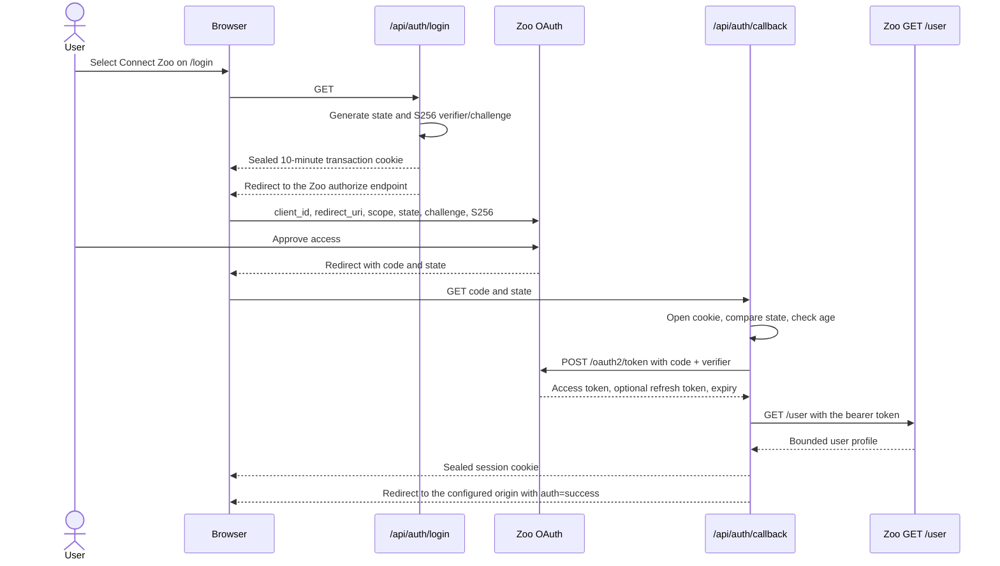

# Zoo OAuth setup

## Two credentials, two jobs

QuoteReady Studio uses **two different Zoo credentials**, and confusing them is
the most common setup problem. Read this section before anything else.

| Credential | Where it comes from | What it is for | Where it is configured |
|---|---|---|---|
| **OAuth session** | Authorization Code + PKCE against the Zoo OAuth application | Identity. The Zoo user ID *is* the workspace tenant: there is no local password, user table or registration | Deployment `.env` (`ZOO_OAUTH_CLIENT_ID`, `ZOO_OAUTH_REDIRECT_URI`) |
| **Personal Zoo API token** | The Zoo dashboard, per user | Doing anything with the account: project library, CAD upload to Zoo, drawing tables, drawing chat | The in-app **09 Settings** page, per user — never in `.env` |

OAuth alone signs a user in and leaves several features disabled. That is not a
misconfiguration; it is an upstream constraint, documented in
[Personal Zoo API token](#personal-zoo-api-token) below.

## What authentication gates

There is **no anonymous access to the application.** Every platform view is
behind `/login`: `apps/web/app/(platform)/layout.tsx` reads the session server
side and redirects when it is missing. A signed-out visitor sees the sign-in
gate and nothing else.

A Zoo session is therefore required for:

- live CAD geometry calls;
- the Zoo project library and CAD upload;
- Zoo copilot recommendations, drawing tables and drawing chat;
- factory machine profiles;
- workspace persistence and lifecycle management;
- the fixed-geometry sample, in practice.

The last point is a common source of stale documentation. The endpoint
`POST /api/analyze?mode=demo` does tolerate an anonymous caller — without a
session it returns an unsaved deterministic report — but no UI route is
reachable without signing in, so in a deployed system every sample run happens
inside an authenticated session and is saved to that user's workspace. Smoke
tests and demo scripts must not instruct anyone to "run the sample while signed
out".

## Required scopes

QuoteReady Studio requests exactly:

```text
user:read modeling
```

- `user:read` reads the authenticated profile.
- `modeling` is the scope Zoo defines for CAD/geometry work.

The scope string is the constant `ZOO_OAUTH_SCOPE` in
`apps/web/lib/oauth.ts`. If Zoo changes its scope contract, update that
constant, the registered application, `apps/web/tests/oauth.test.ts` and this
page together.

> Granting both scopes does **not** unlock the modeling endpoints for a
> third-party OAuth token. See
> [Personal Zoo API token](#personal-zoo-api-token).

## Register the Zoo application

Create a public OAuth application in the Zoo developer settings and register
every environment's callback exactly — scheme, host, port, path and trailing
slash must all match.

```text
http://localhost:3000/api/auth/callback
https://quoteready.example.com/api/auth/callback
```

Copy the public client ID. QuoteReady Studio uses Authorization Code with S256
PKCE and does not send a client secret, so the client ID is the only value to
carry over.

## Environment configuration

Local development, `.env.local`:

```dotenv
ZOO_OAUTH_CLIENT_ID=your-public-client-id
ZOO_OAUTH_REDIRECT_URI=http://localhost:3000/api/auth/callback
QUOTE_READY_SESSION_SECRET=replace-with-at-least-32-random-characters
```

Docker deployment, `.env`:

```dotenv
QUOTEREADY_HOST=quoteready.example.com
TZ=Europe/Rome
ZOO_OAUTH_CLIENT_ID=your-public-client-id
ZOO_OAUTH_REDIRECT_URI=https://quoteready.example.com/api/auth/callback
QUOTE_READY_SESSION_SECRET=replace-with-at-least-32-random-characters
```

`.env.example` ships a real default hostname for the maintainer's deployment —
replace `QUOTEREADY_HOST` and `ZOO_OAUTH_REDIRECT_URI` with your own. The full
variable inventory is in
[Operations](OPERATIONS.md#configuration-inventory).

Generate a strong session secret:

```bash
node -e "console.log(require('crypto').randomBytes(32).toString('base64url'))"
```

Do not commit `.env` or `.env.local`.

> **`QUOTE_READY_SESSION_SECRET` does more than sign cookies.** The same
> AES-256-GCM envelope from `apps/web/lib/oauth.ts` also seals each user's
> personal Zoo API token and OpenAI key before they are written to the workspace
> store (`apps/web/lib/user-settings.ts`). Changing the secret invalidates every
> session and transaction cookie **and permanently destroys every stored API
> key** — the sealed values remain, so Settings still reports them as present,
> while the features that use them fail. Treat rotation as a planned,
> user-visible event: see
> [Rotating the session secret](OPERATIONS.md#rotating-the-session-secret).

## Authorization Code and PKCE sequence



Diagram description: the server generates random state and an S256 PKCE pair,
stores the verifier in a short-lived sealed cookie, and redirects the browser to
Zoo. On return it validates that the transaction cookie exists, that `state`
matches, and that the transaction is at most 10 minutes old, then exchanges the
code together with the verifier, reads the Zoo profile, and stores the tokens
only inside a sealed HttpOnly session cookie. The final redirect is built from
`ZOO_OAUTH_REDIRECT_URI`, not from the incoming request URL.

## Cookie properties

Two cookies are involved, both produced by `sealCookie` in
`apps/web/lib/oauth.ts`:

| Cookie | Name | Lifetime | Contents |
|---|---|---|---|
| OAuth transaction | `quoteready_oauth_transaction` | 10 minutes | `state`, PKCE `verifier`, `createdAt` |
| Application session | `quoteready_zoo_session` | 30 days absolute | Access token, optional refresh token, expiry, issue time, absolute expiry, bounded user profile |

Both are:

- `HttpOnly`;
- `SameSite=Lax`;
- scoped to path `/`;
- `Secure` when `NODE_ENV=production`;
- encrypted and authenticated with AES-256-GCM;
- versioned with a `v1` envelope prefix.

The key is the SHA-256 digest of `QUOTE_READY_SESSION_SECRET`. Each envelope
carries a random 12-byte IV and the GCM authentication tag, and is serialised as
`v1.<iv>.<ciphertext>.<tag>` in base64url. Tampering, a non-canonical base64url
segment, a wrong version prefix and any decryption failure all return no session
rather than an error.

Session validity is re-checked on every read: a session is discarded if the
access token or user ID is missing, if the timestamps are not finite, if it was
issued more than 60 seconds in the future, if the absolute expiry has passed, or
if the declared lifetime exceeds 30 days by more than a minute. A cookie with
altered expiry metadata therefore cannot outlive the absolute cap.

## Redirect-origin behaviour

Behind a reverse proxy, `request.url` may carry an internal address. The
callback therefore builds the post-login redirect from `ZOO_OAUTH_REDIRECT_URI`
(`createOAuthHomeUrl`):

```text
callback: https://quoteready.example.com/api/auth/callback
result:   https://quoteready.example.com/?auth=success
```

This is what prevents a post-authorization redirect to `https://0.0.0.0:3000/`.

## Token lifecycle

### Exchange

- `POST https://api.zoo.dev/oauth2/token`;
- `application/x-www-form-urlencoded` body with `client_id`,
  `grant_type=authorization_code`, `code`, `code_verifier` and `redirect_uri`;
- 15-second timeout;
- response read with a 64 KiB ceiling;
- accepted only when the response is successful and `access_token` is a string;
  anything else becomes a `502` carrying Zoo's `error_description`.

### Profile

- `GET https://api.zoo.dev/user` with the bearer token;
- 15-second timeout;
- response read with a 256 KiB ceiling;
- a string `id` is required; `name` falls back to `first_name last_name` and
  then to `Zoo user`;
- ID, name, email and image are all length-capped (200 / 160 / 320 / 2048).

### Refresh

The refresh request sends the public client ID, `grant_type=refresh_token` and
the current refresh token. A refresh is attempted when the access token is
within 60 seconds of expiry. A rotated refresh token replaces the previous
value; otherwise the previous value is kept. The absolute 30-day session age
does **not** reset. A failed refresh deletes the session cookie, so the user is
asked to sign in again rather than left with a silently broken session.

### Logout and revocation

`POST /api/auth/logout` verifies the request is same-origin, then calls
`POST https://api.zoo.dev/oauth2/token/revoke` (10-second timeout) once for each
unique access and refresh token, and deletes the local cookie regardless of the
outcome. A remote failure is reported as `revoked: false`; the local session is
removed either way.

## Personal Zoo API token

### Why it is required

Zoo's OAuth scope set is `user:read`, `modeling` and `admin:write`. There is no
`projects` scope and no ML scope. An access token obtained through the
documented third-party Authorization Code + PKCE flow — with both `user:read`
and `modeling` granted — is accepted by `GET /user` and answered with
**HTTP 403** by `/file/*`, `GET`/`POST /user/projects` and
`wss://api.zoo.dev/ws/ml/copilot`.

This is the single largest integration constraint in the project. The full field
report, with reproductions, is in
[Zoo API notes](ZOO_API_NOTES.md#authentication-and-scopes).

### How the application handles it

`resolveProjectsToken()` in `apps/web/lib/zoo-projects.ts` resolves the token
for every server-side Zoo call:

1. read the signed-in user's sealed personal token from their stored settings;
2. verify it with `GET https://api.zoo.dev/user` and accept it only if the
   returned `id` equals the signed-in Zoo user ID — so one user's token can
   never be used to act as another;
3. cache that verification for 10 minutes (at most 200 entries, cleared
   wholesale when full);
4. otherwise fall back to the OAuth access token.

Features that provably cannot work on an OAuth token — library listing, CAD
upload to Zoo, drawing-table generation and drawing chat — refuse early with an
actionable `409` instead of surfacing a raw upstream 403. Where the call is
attempted and Zoo answers 403 anyway, the response carries a bounded `detail`
naming the token situation.

There is deliberately **no deployment-wide `ZOO_API_TOKEN` environment
variable.** An earlier revision shipped one; it expired, silently broke the
library for every user, and meant one account funded everyone's API quota. It
was removed. An operator cannot provision tokens on users' behalf.

### Configuring it

1. In the Zoo dashboard, create an API token for the account.
2. Sign in to QuoteReady Studio and open **09 Settings**.
3. Paste the token into the Zoo API token field and save. The value is sealed
   with AES-256-GCM before it reaches the store and is never returned to the
   browser — the API only reports a `hasZooApiToken` boolean.
4. Open **03 Zoo library**. A bounded project list is the confirmation that the
   token was accepted.

The token must belong to the same Zoo account as the OAuth session. A token from
a different account fails ownership verification and is ignored, with the
application falling back to the OAuth token — which then produces the usual 403.

## Verification checklist

1. `GET /api/auth/session` returns `configured: true` before login.
2. `/api/auth/login` redirects to the Zoo authorize endpoint.
3. The authorize URL includes both scopes, `state`, `code_challenge` and
   `code_challenge_method=S256`.
4. Approval returns to the exact registered callback.
5. The callback redirects to the public application origin, not an internal
   host.
6. `/api/auth/session` returns the user profile and **no** token fields.
7. Refresh works near expiry, or cleanly requires signing in again.
8. Logout clears the cookie and reports the remote revocation status.
9. Replaying an expired transaction, altering `state`, or tampering with either
   cookie fails closed.
10. After adding a personal Zoo API token in Settings, the library loads and a
    drawing table can be generated.

## Troubleshooting

### `scope must include at least one supported OAuth scope`

Verify that `ZOO_OAUTH_SCOPE` in `apps/web/lib/oauth.ts` is `user:read modeling`
and that the Zoo application has both enabled. Restart the service after any
environment change.

### Redirect URI mismatch

Compare the registered callback and `ZOO_OAUTH_REDIRECT_URI` character for
character. Common causes: HTTP versus HTTPS, a wrong port, a missing
`/api/auth/callback` path, or an unexpected trailing slash.

### Redirect to `0.0.0.0:3000`

Set `ZOO_OAUTH_REDIRECT_URI` to the externally visible callback. The post-login
URL is derived from that value precisely to avoid internal proxy addresses.

### `OAuth setup needed`

The application reports OAuth as configured only when the client ID and redirect
URI are both non-empty **and** the session secret is at least 32 characters.
Inspect the container environment, not only the host file:

```bash
docker exec quoteredy-studio printenv ZOO_OAUTH_CLIENT_ID ZOO_OAUTH_REDIRECT_URI
```

Do not print the session secret; check its length instead.

### Session disappears immediately

Check that:

- the session secret is stable across restarts (a regenerated secret invalidates
  every cookie);
- production is served over HTTPS, so the `Secure` cookie is actually sent;
- the host clock is correct — the absolute-age checks are timestamp based;
- the grant still permits refresh;
- browser cookie policy is not blocking the application origin.

### Sign-in works but the library, upload or drawings are refused

Expected without a personal Zoo API token. See
[Personal Zoo API token](#personal-zoo-api-token).

### A stored API key stopped working for everyone at once

`QUOTE_READY_SESSION_SECRET` was changed. The sealed values can no longer be
opened, and Settings still reports the secrets as present. Every user must
re-enter their Zoo API token and OpenAI key. See
[Rotating the session secret](OPERATIONS.md#rotating-the-session-secret).

## Production checklist

- use an HTTPS callback;
- keep the session secret outside source control, and back it up separately from
  the data it protects;
- restrict the OAuth application's redirect URIs to known origins;
- rotate the session secret only as a planned event, communicating that users
  must re-enter their API keys;
- monitor refresh and revocation failure rates without ever logging tokens;
- preserve `X-Forwarded-Proto=https` through Traefik so the application knows it
  is behind TLS;
- review scopes whenever product capabilities change;
- tell users up front that a personal Zoo API token is required for the library,
  CAD upload and drawings.

## Related documents

- [Zoo API notes](ZOO_API_NOTES.md) — the upstream findings behind the
  personal-token requirement.
- [Deployment](DEPLOYMENT.md) — registering the callback during a deployment.
- [Operations](OPERATIONS.md) — configuration inventory, secret rotation,
  incidents.
- [Internal HTTP API](API.md) — the auth routes and their status codes.
- [Security](SECURITY.md) — the full control set.
