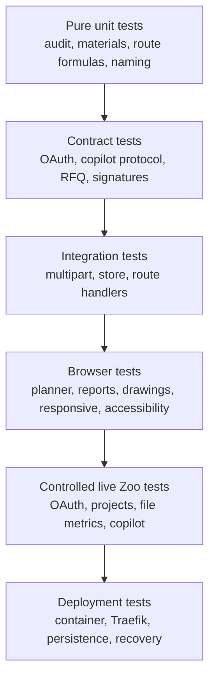

# Testing strategy

## Objectives

Testing must establish more than a successful UI render. The critical claims
are:

1. untrusted requests are bounded before expensive work;
2. authentication and origin checks precede private mutation/upload handling;
3. Zoo geometry is never confused with fixed or declared data;
4. readiness deductions are deterministic and explainable;
5. manufacturing routes remain finite, bounded, and factory-consistent;
6. Zoo Agent cannot introduce unknown routes or unsafe commercial values;
7. fallback returns a complete deterministic plan;
8. report/folder/machine mutations preserve workspace ownership and invariants;
9. the interface remains readable, responsive, keyboard-usable, and honest;
10. the production container can be deployed, observed, backed up, and restored.

## Layered strategy



In prose: fast deterministic tests protect the mathematical and validation core.
Contract tests protect the boundaries with OAuth, uploads and the ML copilot.
Integration tests verify streams, persistence and HTTP behaviour. Browser tests
cover the user workflow. Controlled live checks detect external contract drift.
Deployment tests prove that the exact container and storage topology are
operable. A release needs evidence at every applicable layer; the first two
layers are automated today, the rest are manual.

## Standard commands

Install from the lockfile and run the complete local gate:

```bash
npm ci
npm run check
npm run build
```

`npm run check` runs, in order:

```text
npm run typecheck    tsc --noEmit in all three workspaces
npm run lint         ESLint (eslint-config-next), --max-warnings=0
npm test             Vitest across the three workspace projects
npm run format:check Prettier
```

Useful focused commands:

```bash
npm run typecheck
npm run lint
npm test
npm run format:check
npm run build
```

Two scope details that regularly surprise contributors:

- `format` and `format:check` cover only
  `apps/web/**/*.{ts,tsx,css}`, `packages/*/src/**/*.ts`,
  `packages/*/tests/**/*.ts` and `*.{json,mjs}`. **Markdown, `docs/`,
  `docker-compose.yml`, `Dockerfile` and `.env.example` are not
  Prettier-checked** — format documentation by hand.
- `vitest.config.ts` at the root only aggregates three project configs; a test
  file outside `apps/web/tests`, `packages/core/tests` or
  `packages/storage/tests` will silently not run.

Do not substitute development-server success for the production build. Next.js
route and runtime boundaries and the standalone output are verified only by
`npm run build`.

## Current automated coverage

The suite contains **118 tests across 13 files**, distributed over the three
workspace projects (`apps/web`, `packages/core`, `packages/storage`). 117 run by
default; one is an opt-in live Zoo contract test that is skipped unless a token
is supplied.

| File | Tests | Covers |
|---|---:|---|
| `packages/storage/tests/platform-store.test.ts` | 22 | Quotas, ownership isolation, folder purge/release, attachments, revision lineage, part-name policy, selected-route membership |
| `apps/web/tests/drawing-sheet.test.ts` | 19 | Sheet composition, view projection, scale selection, annotation and balloon placement, table cross-referencing |
| `apps/web/tests/item-naming.test.ts` | 15 | `{part}_NN` sequences, `{part}_{date}` result titles, stem sanitisation, timezone handling, collision reuse rules |
| `packages/core/tests/zoo-copilot.test.ts` | 15 | Copilot frame reducer, cumulative-text abort, MsgPack replay decoding, reconnect classification, harvesting, diagnostics |
| `apps/web/tests/result-context.test.ts` | 13 | Attachment→RFQ context merge, idempotent re-run notes, revision chains, part resolution |
| `apps/web/tests/security.test.ts` | 7 | Origin checks, bounded readers, content-type enforcement, rate windows, single-flight, RFQ validation, file signatures |
| `packages/core/tests/manufacturing.test.ts` | 6 | Deterministic routes, factory matching, agent payload acceptance and rejection |
| `apps/web/tests/oauth.test.ts` | 5 | PKCE pair, requested scopes, cookie seal/open round-trip, tamper rejection, proxy-safe redirect origin |
| `apps/web/tests/multipart.test.ts` | 4 | Streaming parser, declared-size rejection, duplicate-field rejection |
| `packages/core/tests/audit.test.ts` | 4 | Readiness scoring, blocking versus advisory checks, evidence provenance |
| `packages/core/tests/user-memory.test.ts` | 4 | Workshop-memory distillation and bounded prompt rendering |
| `packages/core/tests/parts.test.ts` | 3 | Part-name normalisation, collision detection, supersede visibility |
| `packages/core/tests/zoo-copilot.live.test.ts` | 1 | Opt-in live copilot contract check (skipped by default) |

These are strong regression anchors for the domain layer, not route or browser
coverage. The largest untested surfaces are listed under
[Current gaps and next tests](#current-gaps-and-next-tests) and in
[Limitations](LIMITATIONS.md#testing-boundaries).

## Release verification template

Record this evidence for the exact submitted revision; do not carry a previous
release's snapshot forward.

| Gate | Expected |
|---|---|
| `npm ci` | Clean install from the lockfile |
| `npm run typecheck` | Passes in all three workspaces |
| `npm run lint` | Passes with zero warnings |
| `npm test` | 117 passed, 1 skipped, 13 files |
| `npm run format:check` | Passes (TypeScript, CSS, JSON and mjs only) |
| `npm run build` | Standalone output produced |
| `npm audit` | No unaccepted critical or high finding |
| `docker compose config --quiet` | Valid expansion |
| Container state | All long-lived services `healthy`; `quoteredy-minio-init` exited 0 |
| Foreign `Origin` mutation | Rejected with HTTP 403 |
| Browser headers | CSP and every documented header present on the public origin |
| PDF export | One report PDF and one drawing PDF render (proves Chromium) |
| Browser flows | Desktop and mobile without console errors or horizontal overflow |
| Mobile navigation | Drawer opens, Escape dismisses, focus returns |

Re-run the full gate after any source, lockfile, environment, proxy or image
change. Evidence is only valid for the exact image and date it was collected on.

## Required unit matrix

### Readiness audit

| Case | Expected result |
|---|---|
| All required evidence | 100 or expected complete score, `ready`, no invented question |
| Volume missing | 30-point blocking deduction |
| Units unknown | 18-point blocking deduction |
| Material unknown | 16-point blocking deduction |
| Quantity missing | 10-point advisory deduction |
| Tolerance missing | 12-point advisory deduction |
| Drawing absent | 8-point advisory deduction |
| Finish missing | 6-point advisory deduction |
| Process unknown | 6-point advisory deduction |
| Density known but mass absent | 5-point advisory deduction |
| Multiple failures | Score never below 0; questions remain capped/bounded |
| Sample evidence | Trace says fixed sample, never Zoo |
| Drawing present | Text says presence only, never semantic validation |

### Deterministic manufacturing

Test every supported material/process combination at quantities 1, typical
batch, and 1,000,000. Assert:

- at least five stable route IDs;
- finite positive price components;
- `minimum <= expected <= maximum`;
- confidence remains in `[0, 1]`;
- lead time is positive and finite;
- suitability remains bounded;
- operation order remains stable;
- no machine match means unavailable;
- every operation covered means available;
- empty machine material coverage means all supported materials;
- disabled machines do not satisfy coverage;
- user rates/setup values affect only matching operations;
- extreme geometry remains finite within input metric ceilings.

### Zoo Agent validation

For each field, cover accepted boundaries and failures:

- exact known route count and unique IDs;
- known recommended route;
- summary length 8–1200;
- nonempty rationale no longer than 800;
- price order, finite values, EUR currency, confidence `[0,1]`;
- expected price inside the deterministic 0.25×–4× envelope;
- lead time inside the deterministic 0.25×–4× envelope;
- reasons/risks: at most six nonempty strings, each at most 240 characters;
- fenced/plain structured payload extraction;
- output over 128 KiB;
- malformed frames, timeout, socket error, or premature close;
- fallback preserves deterministic IDs, operations, availability, and bounds.

## HTTP and integration matrix

### Authentication and body-ordering

Instrument or spy on body readers to prove:

- live analysis returns 401 before multipart parsing when signed out;
- private platform/factory/report/project routes return 401;
- state-changing private routes reject foreign/missing origins before mutation;
- logout clears local cookie state even if upstream revocation is unavailable;
- expired sessions refresh only within the configured window;
- invalid/tampered session cookies expose no private data.

### Request limits

Cover exact limit minus one, exact limit, and limit plus one where applicable:

| Boundary | Limit |
|---|---:|
| General JSON | 32 KiB |
| Sample JSON | 16 KiB |
| Multipart total | 32 MiB |
| CAD file | 20 MiB |
| Drawing file | 10 MiB |
| Multipart files | 2 |
| Multipart fields | 12 |
| Multipart parts | 14 |
| Field name | 64 bytes/characters as parser contract |
| Field value | 4 KiB |

Also cover chunked bodies without `Content-Length`, false low declared lengths,
duplicate fields/files, unexpected file fields, truncated streams, empty CAD,
and per-file overflow while total remains under its ceiling.

### RFQ contract

Test every allowed field and reject every unknown field. Cover:

- part name 140-character boundary;
- process/material/unit allowlists;
- quantity null, 1, 1,000,000, zero, fractional, unsafe integer, and text;
- tolerance/finish 160-character boundaries;
- notes 2,000-character boundary;
- source project IDs/names at their bounds;
- server-derived `hasDrawing` overriding any client attempt;
- Unicode/control-character handling according to the documented parser.

### Persistence

Every persistence rule must hold identically on both drivers, because
`WorkspaceStore` owns the invariants and the driver only supplies `read` and
`mutate`. Run each group twice: with `QUOTEREADY_STORAGE_DRIVER=json` against an
isolated temporary `QUOTEREADY_DATA_DIR`, and with `postgres` against a
disposable database.

Cover:

- empty-store initialisation;
- atomic replacement without a leftover temp file (JSON), and rollback on a
  failed transaction (Postgres);
- corrupt JSON, oversized file, and a malformed stored workspace shape;
- backfill of `documents` / `parts` / `drawings` and normalisation of a
  non-array `attachments` on load;
- boundaries for folders 200, machines 100, results 250, documents 250,
  parts 250, drawings 100, attachments 20 per result, and the 64 MiB serialised
  ceiling;
- ownership isolation between users, for both records and blob keys;
- parent-folder existence, and folder deletion in both `purge` and `release`
  mode including child re-parenting;
- selected-route membership;
- title/folder/archive/trash/tag patch combinations;
- archived and trashed items still counting toward quota until the trash is
  emptied;
- the part-name policy: `allow`, `reject` producing `PartNameConflictError`, and
  `supersede` hiding the previous record while keeping it and its blobs;
- the parts rolling-log eviction, including the case where every part is
  `analyzing`;
- attachment add/remove, and blob sharing across a re-run so bytes are deleted
  only when nothing references them;
- concurrent same-process mutations retaining every accepted write;
- a failed mutation leaving the previous valid state unchanged;
- file mode and ownership expectations in the container.

Blob-store tests should additionally cover key-pattern rejection, traversal
rejection, filename sanitisation, and path containment on the filesystem driver.

### Rate and concurrency controls

Use a controllable clock. Verify:

- live analysis accepts six requests/minute and rejects the next;
- sample accepts ten requests/minute and rejects the next;
- fixed windows reset only at the boundary;
- expired identities are removed during maintenance sweeps;
- the 10,000-bucket process ceiling fails closed with `503` when no expired
  entry can be reclaimed;
- authenticated identity keys do not collide;
- anonymous identity prefers `CF-Connecting-IP`, falls back to the first
  `X-Forwarded-For` value, and strips non-address characters;
- a second active live analysis for the same user is rejected;
- single-flight is released after success, input failure, Zoo failure, and
  thrown exception;
- limits are explicitly process-local.

## CAD and drawing fixture matrix

Use minimal synthetic files with no confidential geometry.

| Format | Positive fixture | Negative fixture |
|---|---|---|
| STEP/STP | `ISO-10303-21` header | PDF/HTML renamed `.step` |
| STL | valid minimal binary or ASCII solid | too short/truncated content |
| OBJ | representative vertex/face text | unrelated text |
| PLY | `ply` header | renamed executable/document |
| SLDPRT/IPT/SAT/X_T/X_B | safe representative sample | obvious foreign signature |
| PDF | `%PDF-` | PNG/text renamed `.pdf` |
| PNG | standard 8-byte signature | JPEG renamed `.png` |
| JPEG | SOI marker | PDF renamed `.jpg` |

Native format checks are intentionally shallow. Tests must not imply semantic
or malware validation.

## Controlled live Zoo contract tests

Live tests are opt-in and use a dedicated account, synthetic project, and
revocable authorization. They must not run on every untrusted contribution.

### OAuth

- authorization URL accepts `user:read modeling`;
- state and verifier are one-time and expire after ten minutes;
- callback exchanges the code and lands on the configured public origin;
- refresh preserves the local user session;
- logout attempts revocation and always clears local state.

### Projects

- `/user/projects?limit=50` returns the documented shape;
- empty, one-page, and maximum-page states render;
- timeout, non-JSON, oversized response, and authorization failure remain
  bounded and readable;
- selected project metadata appears in the report but does not claim geometry
  import.

### File metrics

For each supported synthetic CAD fixture:

- upload succeeds or returns a sanitised, actionable failure;
- volume, surface, centre of mass, and material mass operations are traced;
- polling stops at a terminal state, the per-operation cap, or the global
  deadline;
- finite values and units are normalised correctly;
- one failed metric does not erase successful metrics;
- missing volume blocks readiness;
- no CAD or drawing bytes appear in the workspace store — only blob keys.

### CAD conversion and the drawing pipeline

- `POST /file/conversion/{fmt}/gltf` returns a parseable glTF for each supported
  source format, and an oversized response is rejected at the 48 MiB ceiling;
- a conversion failure degrades to "no preview" without failing the analysis;
- the stored glTF parses into a mesh with plausible millimetre bounds;
- a model above 250 000 triangles is refused rather than truncated;
- a drawing sheet renders for a part with a model, and renders with a printed
  reason and scale `NTS` for a part without one;
- balloon numbers match dimension-table row numbers.

### ML copilot

- the in-band authentication frame is accepted and `session_data` follows;
- streamed deltas combine into one bounded response;
- a valid pricing response passes the contract, and an unavailable or invalid one
  returns the deterministic fallback;
- a mid-turn interrupt reconnects with replay, resumes with `continue`, and does
  not duplicate streamed text;
- accumulated tool output is accepted when the closing frame never arrives;
- the pricing context contains no raw CAD or drawing bytes, no OAuth token, no
  session secret and no machine notes;
- the drawing prompt *does* attach the CAD file — assert that this is the only
  prompt that does.

### Detailed reports (OpenAI)

- no request is made without a stored key;
- a non-HTML answer is rejected with an actionable message;
- `<script>` elements, inline handlers and `javascript:` URLs are stripped from
  the stored HTML;
- an oversized document is rejected at the 500 KiB cap;
- a failed generation is persisted as `failed` with a bounded error rather than
  leaving the document in `generating`.

Record the Zoo endpoint version and date, request category, status, timing,
terminal state and sanitised trace, so contract drift can be distinguished from
an application regression. `packages/core/tests/zoo-copilot.live.test.ts` is the
opt-in harness for the copilot half of this.

## Manual interface matrix

Test at minimum at 1440×900, 1024×768, 390×844, and 320×568. Also inspect both
sides of the actual 1180, 900, 760, and 430 px CSS breakpoints. Repeat key
flows at 200% browser zoom.

| Area | Checks |
|---|---|
| Global shell | No clipped nav/content; active view clear; skip link works |
| Typography | Body, labels, metadata, and buttons readable; no oversized empty-state text |
| Planner | Labels map to controls; errors adjacent; file state announced/readable |
| Analysis loading | Action disabled appropriately; progress text honest; no duplicate submit |
| Report | Score/status, metrics, checks, questions, assumptions, and provenance legible |
| Route comparison | Price/time/availability comparable without horizontal ambiguity |
| Factory | Create/delete and empty/error states; keyboard operation |
| Zoo projects | Loading/empty/error/selection states; selected context explicit |
| Parts | 3D preview loads, fails gracefully without a model, and does not trap focus |
| Drawings | `generating` / `ready` / `failed` states; chat turn round-trip; PDF download |
| Results | Attachment upload and removal; re-run producing a linked revision |
| Overwrite dialog | Duplicate part name prompts confirmation; cancel leaves state untouched |
| Reports | Filters, folders, archive, trash, selection, and reload persistence |
| Library tables | Search, status and tag filters, and column sorting on all four views |
| Themes | Every view legible in both light and dark; no hardcoded colour survives |
| Navigation drawer | Opens/closes by keyboard; Escape works; focus returns logically |
| Focus | Visible on every interactive control and not hidden under overlays |
| Colour | Status understandable without colour; contrast manually or automatically checked |
| Motion | No essential information depends on animation; reduced-motion behaviour checked |

Keyboard-only script:

1. load and activate the skip link;
2. sign in, then reach **Run sample** without pointer input;
3. inspect report sections and route controls;
4. open/close mobile navigation with Enter/Space and Escape;
5. sign out using visible focus;
6. create a machine and manage a result;
7. start a drawing table and download its PDF;
8. confirm focus order follows visual and semantic order.

Screen-reader spot checks should cover page title, landmarks, form labels,
validation messages, loading status, report status, route availability, dialog
or drawer semantics, and meaningful icon names.

## Deployment verification

Run against the exact image, from the stack directory:

```bash
docker compose config --quiet
docker compose up -d --build
docker compose ps
docker exec quoteredy-studio wget -qO- http://127.0.0.1:3000/api/health
```

Then verify:

- all long-lived services report `healthy`, and `quoteredy-minio-init` exited 0;
- the application runs as UID/GID `1000:1000` with `no-new-privileges:true` and
  all capabilities dropped;
- no host ports are published by any service;
- only the application is attached to the external `proxy_public` network, and
  `quoteredy_internal` is `internal: true`;
- resource limits are 2 GiB/2 CPUs for the application, 1 GiB/1 CPU for Postgres
  and 512 MiB/0.5 CPU for MinIO;
- log rotation is 10 MiB × 3 files;
- public health answers through Traefik;
- **PDF rendering works** — download one report PDF and one drawing PDF, which is
  the only routine proof that the bundled Chromium is functional;
- data persists across container recreation, in Postgres *and* in MinIO;
- a missing or unwritable bind mount fails visibly rather than silently starting
  with an empty store;
- backup and restore work on a disposable copy of both stores.

Remember that `/api/health` is a static literal: a container can report `healthy`
while Postgres or MinIO is down. Verify the data layer explicitly — see
[Operations](OPERATIONS.md).

## Security regression checklist

- [ ] No credential or session value appears in client bundles or logs.
- [ ] Cookie flags are HttpOnly, SameSite=Lax, Secure in production, path `/`.
- [ ] OAuth state, PKCE, transaction expiry, and tamper rejection pass.
- [ ] Private reads require a valid session.
- [ ] Mutations require same origin and the applicable content type.
- [ ] Upload, JSON, Zoo, project, copilot and OpenAI response ceilings hold.
- [ ] Filename/content mismatch tests fail as designed.
- [ ] Workspace IDs cannot cross user boundaries, and neither can blob keys.
- [ ] Blob keys reject traversal and non-conforming patterns.
- [ ] Stored Zoo and OpenAI secrets never appear in an API response — only the
      `hasZooApiToken` and `hasAiApiKey` booleans.
- [ ] Unknown agent routes and unsafe numeric values fall back deterministically.
- [ ] AI-authored HTML has scripts, inline handlers and `javascript:` URLs
      stripped, and renders in a sandboxed iframe.
- [ ] The PDF renderer runs with page JavaScript disabled.
- [ ] No service has a direct inbound port, and the application runs non-root.
- [ ] Dependency and image scans have no unaccepted critical or high issue.

See [Security review](SECURITY_REVIEW.md) for residual risks that tests cannot
eliminate.

## Test-data rules

- Use synthetic geometry and drawings created for testing.
- Never commit `.env`, tokens, cookies, private project names, or user exports.
- Use a dedicated Zoo account and OAuth application for live tests, and a
  dedicated personal Zoo API token that can be revoked independently.
- Revoke test authorisation when it is no longer needed.
- Sanitise IDs and response bodies before attaching them to a report; quote
  `session_data.api_call_id` rather than any token.
- Keep expected sample values versioned and clearly labelled as fixed.
- Store no production workspace dump, database dump or blob bucket in fixtures —
  they contain sealed user secrets.

`apps/web/tests/fixtures/slotted-block.ts` is the in-repository mesh fixture used
by the drawing-sheet tests; extend it rather than adding binary CAD to the repo.

## Release evidence template

Record this for the exact submitted revision:

```text
Revision:
Date/time and timezone:
Node/npm versions:
npm ci:
npm run typecheck:
npm run lint:
npm test (files / passed / skipped):
npm run format:check:
npm run build:
npm audit:
Compose expansion:
Container health (all four services):
Public health:
Sample workflow:
Live Zoo workflow fixture/result:
Drawing table + A3 PDF:
Detailed report + A4 PDF:
Re-run revision lineage:
Fallback workflow:
Desktop/narrow/keyboard checks:
Light and dark theme check:
Backup/restore check (Postgres + MinIO):
Known accepted limitations:
Reviewer:
```

Do not report a passing suite without naming the revision and the commands.

## Current gaps and next tests

No test currently imports a route handler from `apps/web/app/api`, so the entire
HTTP layer is verified by hand. That is the single largest gap.

Highest-priority missing automation:

1. route-handler tests covering auth-before-body ordering and status mapping,
   including the `409` part-name-conflict contract and the `overwrite` retry;
2. exact multipart boundary and stream-truncation coverage;
3. quota, atomic-write failure and concurrent-mutation tests on **both** storage
   drivers;
4. rate-window and single-flight release tests with a controllable clock;
5. attachment, re-run and 3D-part-replacement flows end to end;
6. Chromium PDF rendering, including the `503` path when no binary is present;
7. drawing-chat turn handling and the drawing JSON bounding rules;
8. OpenAI report generation, sanitisation and failure persistence;
9. browser end-to-end coverage for the sample, private, live-mocked and report
   flows, in both themes;
10. automated accessibility and visual regression checks;
11. controlled live Zoo contract tests with sanitised fixtures, beyond the single
    opt-in copilot test;
12. container persistence and restore tests in a disposable environment.

Until those are automated, the corresponding manual checks in this document are
release gates, not optional exploratory work.

## Related documents

- [Internal HTTP API](API.md) — the exact limits and status codes to assert.
- [Data model](DATA_MODEL.md) — the invariants the store tests protect.
- [Zoo Agent](ZOO_AGENT.md) — the validation contract and its current coverage.
- [Security review](SECURITY_REVIEW.md) — residual risks tests cannot eliminate.
- [Operations](OPERATIONS.md) — backup, restore and health verification.
