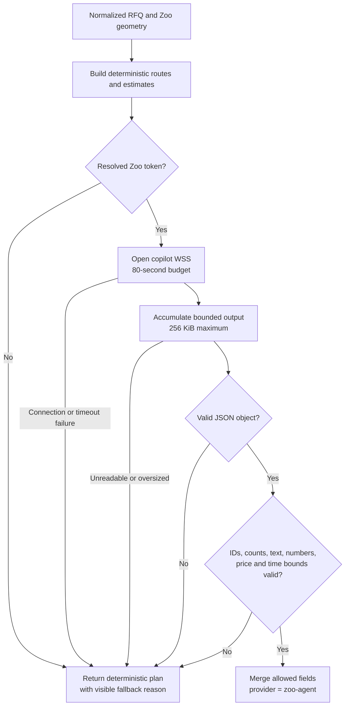

# Zoo Agent integration

QuoteReady Studio drives Zoo's ML copilot (`wss://api.zoo.dev/ws/ml/copilot`)
from three different prompts. They share one websocket client,
`runCopilotPrompt` in `packages/core/src/zoo-copilot.ts`, but they have very
different contracts and budgets:

| Prompt | Where | Budget | Sends CAD? | Answer contract |
|---|---|---:|---|---|
| **Manufacturing cost engineer** | `packages/core/src/pricing.ts` | 80 s | No | Strict numeric contract, validated and merged (this document) |
| **Drafting engineer** | `apps/web/lib/drawing-generation.ts` | 5 min, 2 attempts | **Yes** | Bounded JSON drawing table |
| **Drawing chat** | `apps/web/lib/drawing-generation.ts` | 120 s | No | Bounded JSON drawing table plus a one-sentence reply |

All three run with `forced_tools: []`, which requests a text-only answer and
keeps the copilot from modelling or rendering anything.

Most of this page documents the **pricing** prompt, because it is the one whose
output is allowed to change a commercial number and therefore carries the
strictest contract. The drawing prompts are covered in
[Drawing prompts](#drawing-prompts). For the upstream protocol behaviour that
shapes all three — in-band authentication, backend recycling, replay resume — see
[Zoo API notes](ZOO_API_NOTES.md).

## Purpose

The pricing prompt is the recommendation layer for authenticated analyses. It
receives a bounded manufacturing context after deterministic evidence and route
candidates already exist. Its role is to:

- rank the supplied manufacturing routes;
- refine preliminary EUR ranges and elapsed lead time;
- explain suitability;
- identify route-level risks;
- produce the executive manufacturing recommendation.

Zoo Agent does not create geometry metrics, invent route IDs, add operations,
or fill missing authoritative RFQ requirements. The deterministic plan remains
the structural baseline and the complete fallback.

## Invocation conditions

`buildManufacturingPlan()` always constructs the deterministic plan first.
The agent is attempted only when the analysis has a resolved Zoo token:

- anonymous sample: deterministic only;
- authenticated sample: the agent may be attempted, then report persistence;
- authenticated live analysis: Zoo geometry first, then the agent, then report
  persistence.

The token comes from `resolveProjectsToken()`, which prefers the user's personal
Zoo API token from Settings and falls back to the OAuth access token. In practice
Zoo's ML endpoints reject third-party OAuth tokens, so without a personal token
the socket fails to open and the analysis simply lands on the deterministic plan
with a visible `fallbackReason` — the product still works, the recommendation is
just not AI-refined. The drawing prompts, which have no equivalent fallback,
refuse up front with `409` instead. See
[Zoo API notes, AUTH-1](ZOO_API_NOTES.md#auth-1--third-party-oauth-tokens-are-rejected-by-every-interesting-endpoint).

The connection target is fixed in server code:

```text
wss://api.zoo.dev/ws/ml/copilot
```

The browser never receives the bearer token and never connects to the socket
directly.

## Context sent to Zoo Agent

The message includes fixed manufacturing instructions and a JSON object with:

- normalized RFQ metadata;
- geometry metrics;
- readiness score;
- each deterministic candidate's ID, name, suitability, factory availability,
  deterministic price, deterministic lead time, and operations.

The outer WebSocket message includes:

```json
{
  "type": "user",
  "content": "bounded manufacturing instructions and context",
  "project_name": "QuoteReady Studio — part name",
  "forced_tools": []
}
```

`forced_tools: []` requests a text-only answer, so the copilot performs no
modelling or rendering. The prompt message is preceded on every connection by
the in-band authentication frame Zoo requires
(`{"headers":{"Authorization":"Bearer …"}}`).

Server frames are single-key JSON objects: `{"delta":{"delta":…}}` streams the
answer, `{"error":{"detail":…}}` aborts it, and
`{"end_of_stream":{"whole_response":…}}` terminates the turn.
`session_data`, `conversation_id`, `reasoning`, `backend_shutdown`,
`tool_output` and `project_updated` are consumed as liveness, resume and
diagnostic signals; everything else is ignored. The complete observed protocol
is documented in [Zoo API notes](ZOO_API_NOTES.md#ml-copilot-wire-protocol-as-observed).

**No raw CAD or drawing bytes are included in the pricing prompt.** Geometry has
already been reduced to numeric metrics by the Zoo File API. Factory machine
names and notes are not sent either — only route-level factory availability and
the deterministic operations and estimates enter the request. (The *drawing*
prompt does attach the CAD file; see [Drawing prompts](#drawing-prompts).)

### Per-user workshop memory

When the user has previous saved reports, the instructions also include a
bounded "User workshop history" section distilled server-side by
`@quoteredy/core/user-memory` from up to 50 non-trashed reports:

- distribution of routes the user ended up selecting (top 3, with share);
- routes the user manually chose over the recommendation (tracked via
  `manufacturingPlan.routeSelectedByUser`, set on manual route selection);
- most frequent declared materials (top 3) and the median declared quantity;
- share of selected routes available in the user's own factory.

The section is explicitly framed as a soft tie-breaking signal: the prompt
instructs the Agent to ignore it whenever it conflicts with the current part's
evidence, and the numeric validation contract below applies unchanged, so
memory can never move an estimate outside the deterministic bounds. The
rendered section is capped at 1,500 characters and contains no free-text user
input beyond material IDs and route names.

## Required response

Zoo Agent must return one JSON object, optionally inside a JSON code fence:

```json
{
  "recommendedRouteId": "cnc-from-billet",
  "summary": "CNC from billet is the most controlled path for this batch.",
  "routes": [
    {
      "id": "cnc-from-billet",
      "minimum": 320,
      "expected": 380,
      "maximum": 470,
      "confidence": 0.78,
      "leadTimeHours": 28,
      "rationale": "The measured geometry and tolerance suit a fixture-based route.",
      "reasons": ["Direct dimensional control"],
      "risks": ["Confirm tool access and workholding"]
    }
  ]
}
```

The real response must contain exactly one entry for every deterministic route.

## Validation contract

### Object-level rules

- response must parse as an object;
- `routes` must be an array with exactly the deterministic route count;
- `recommendedRouteId` must be a supplied deterministic ID;
- route IDs must be known and unique;
- summary must be a trimmed string of 8–1,200 characters.

### Numeric rules

For every route:

- minimum, expected, maximum, confidence, and lead time must be finite numbers;
- `0 < minimum <= expected <= maximum`;
- confidence must be from 0 to 1;
- lead time must be positive;
- minimum may not fall below `0.25 × deterministic expected price`;
- maximum may not exceed `4 × deterministic expected price`;
- lead time must stay within `0.25×–4×` the deterministic lead time.

The asymmetric price check allows uncertainty while rejecting implausibly low
or high envelopes. It does not independently constrain Agent `expected` to the
baseline interval if the overall ordered range remains within the minimum and
maximum bounds; this is an intentional current contract that should be covered
by future policy tests.

### Text normalization

- rationale is trimmed and capped at 800 characters;
- reasons and risks accept strings only;
- every item is trimmed and capped at 240 characters;
- empty items are removed;
- each array is capped at six entries;
- missing usable arrays fall back to deterministic reasons/risks.

### Merge rules

Accepted Agent values may replace:

- recommended route;
- plan summary;
- route description with rationale;
- price range and confidence;
- lead time;
- reasons and risks.

The following remain deterministic:

- route IDs and names;
- suitability score;
- factory-availability result;
- ordered operations, processes, setup/cycle minutes, and details.

All accepted price values are rounded to cents and lead time to one decimal.

## Validation and fallback flow



Diagram description: deterministic routes are always created before any Agent
call. Without a token, or on any connection, timeout, parsing, size, schema, or
engineering-bound failure, the complete deterministic plan is returned with a
visible reason. Only a fully valid response reaches the constrained merge.

## Stream and availability controls

Enforced by `runCopilotPrompt` for every prompt:

| Control | Value |
|---|---|
| WebSocket `maxPayload` per incoming frame | 16 MiB (server frames can carry rendered images as JSON byte arrays) |
| Cumulative accepted text | 256 KiB, then the turn is aborted |
| Ping keepalive interval | 30 s |
| Stall watchdog (no frame at all) | 5 min, then the socket is dropped and the turn resumed |
| Maximum consecutive reconnects | 6, backoff 2 s → 30 s, budget reset while frames flow |
| Turn budget | 80 s pricing · 5 min drawing table · 120 s drawing chat |

Plus: a fixed remote host and bearer authorisation; remote error text is never
copied verbatim into a user-facing message; the socket is closed on settlement.

The cumulative counter applies to `delta` text. The final parser accepts the
accumulated text when an end-of-stream marker arrives, and also when a closed
connection has already produced content — some turns simply end without
`end_of_stream`. On the timeout path, tool output or project files that already
arrived count as a usable answer rather than a failure.

Because Zoo recycles copilot backends mid-prompt, the client reconnects with
`?replay=true&conversation_id=…`, decodes the MsgPack replay frame, re-sends an
explicit `continue` command, and harvests anything the superseded socket already
produced so a truncated replay never discards work. Every failure message carries
diagnostics — conversation state, reasoning-frame count, characters streamed,
tool results, reconnect count and `api_call_id`. The full account of that
upstream behaviour is in
[Zoo API notes, ML-2 and ML-3](ZOO_API_NOTES.md#ml-2--long-turns-are-killed-every-56-minutes-by-a-zookeeper-recycle).

## Deterministic fallback

Fallback is not an empty or degraded response. It contains all five route
candidates, operation sequences, suitability, factory availability, bounded
price ranges, lead times, reasons, and risks. The report stores:

- `provider: "deterministic"`;
- `providerLabel: "Deterministic fallback"`;
- a `fallbackReason` explaining whether authentication was absent or Agent
  output was unavailable/rejected.

This makes the demo resilient and prevents external failure from erasing the
engineering baseline.

## Prompt-injection and authority boundary

RFQ notes are untrusted text. The security design limits their authority rather
than assuming instructions will always be followed:

- metadata fields have request and character bounds;
- candidate IDs and operations are created before Zoo Agent;
- unknown and duplicate IDs are rejected;
- values outside deterministic price/time envelopes are rejected;
- missing authoritative requirements remain explicit audit failures/warnings;
- the report displays provenance and fallback state.

This contract limits impact but does not make free-form text harmless. A future
hardening step should separate user text into a dedicated data envelope and add
adversarial instruction tests.

## Drawing prompts

The other two copilot prompts live in `apps/web/lib/drawing-generation.ts` and
share the JSON contract below, parsed by `parseDrawingResponse`:

```json
{
  "units": "mm",
  "general_tolerance": "ISO 2768-m",
  "datums": [{ "label": "A", "feature": "…", "reason": "…" }],
  "rows": [
    {
      "feature": "…",
      "nominal": "…",
      "tolerance": "…",
      "datums": "A|B",
      "kind": "dimension or gdt",
      "note": "…"
    }
  ],
  "notes": ["…"],
  "reply": "…"
}
```

**Drafting engineer** (`POST /api/drawings`) attaches the part's archived CAD
file as `current_files` and asks the agent to choose the datum reference frame
and the tolerance rows itself. To spare a slow tool loop it is handed everything
already measured — volume, surface area, mass, material, design units and the RFQ
general tolerance — and is explicitly instructed not to model, render or write
files. Budget 5 minutes, retried once on a transient socket error. It runs as a
background job that always writes `ready` or `failed` back onto the record.

**Drawing chat** (`POST /api/drawings/chat`) sends the current table as JSON plus
the user's request, with no CAD attached so the turn stays interactive. The
parsed table replaces `units`, `generalTolerance`, `datums`, `rows` and `notes`
wholesale, and `reply` is shown to the user.

Validation is bounding rather than numeric: at most 6 datums, 40 rows and 10
notes, every text field truncated to 200 characters, the datum reference to 20,
`kind` coerced to `dimension` unless it is exactly `gdt`, row IDs regenerated
server-side. An answer with zero rows is rejected outright. There is **no**
deterministic fallback here — unlike pricing, a failed drawing generation is
recorded as `failed` with its error rather than substituted, because there is no
honest way to invent a datum scheme.

## Privacy boundary

The pricing prompt receives only what a manufacturing recommendation needs: RFQ
fields, geometry metrics, readiness score, route candidates and the distilled
workshop memory. It does **not** receive the original CAD or drawing buffers.

The drawing-table prompt is the exception and must be stated plainly: it uploads
the part's **raw CAD file** to the copilot as a project file, because the agent
cannot choose datums without the geometry. Drawing chat sends no file. Neither
prompt ever receives the uploaded PDF/PNG/JPEG drawing, machine names or machine
notes.

Users should still avoid entering unrelated confidential information in free-text
notes, and operators should treat "a drawing table was generated" as "this CAD
file was sent to Zoo's ML service".

## Test coverage

Two suites cover this integration today.

`packages/core/tests/manufacturing.test.ts` (6 tests) covers the pricing
contract: a complete in-range response is accepted, and unknown route IDs and
unsafe prices are rejected alongside the deterministic route model itself.

`packages/core/tests/zoo-copilot.test.ts` (15 tests) covers the transport:
frame reduction for every handled frame type, cumulative-text abort, MsgPack
replay decoding, reclassification of `connection interrupted` as a reconnect
rather than a failure, replay state reset with harvesting, and the diagnostic
string. Those assertions are where an upstream protocol change will surface
first.

`packages/core/tests/zoo-copilot.live.test.ts` (1 test, skipped by default) is an
opt-in live contract check against the real socket.

Still worth adding:

- every remaining numeric edge of the validation contract — summary length
  8–1 200, rationale 800, reasons/risks 6 × 240, confidence `[0,1]`, both edges
  of the 0.25×–4× price and lead-time envelopes;
- fenced-versus-plain JSON extraction;
- timeout, socket error and premature close each producing the deterministic
  fallback with a visible provider label and reason;
- deterministic operations, route IDs, names, suitability and factory
  availability provably unchanged after a merge;
- the drawing contract: bounding of datums, rows and notes, `kind` coercion, and
  rejection of a zero-row answer.

See [Testing](TESTING.md) and [Limitations](LIMITATIONS.md).

## Related documents

- [Zoo API notes](ZOO_API_NOTES.md) — the observed copilot protocol and the
  upstream defects this client works around.
- [Data model](DATA_MODEL.md) — `ManufacturingPlan` and `DrawingTable`.
- [Internal HTTP API](API.md) — the routes that trigger each prompt.
- [Architecture](ARCHITECTURE.md) — where the agent sits in the request flow.
